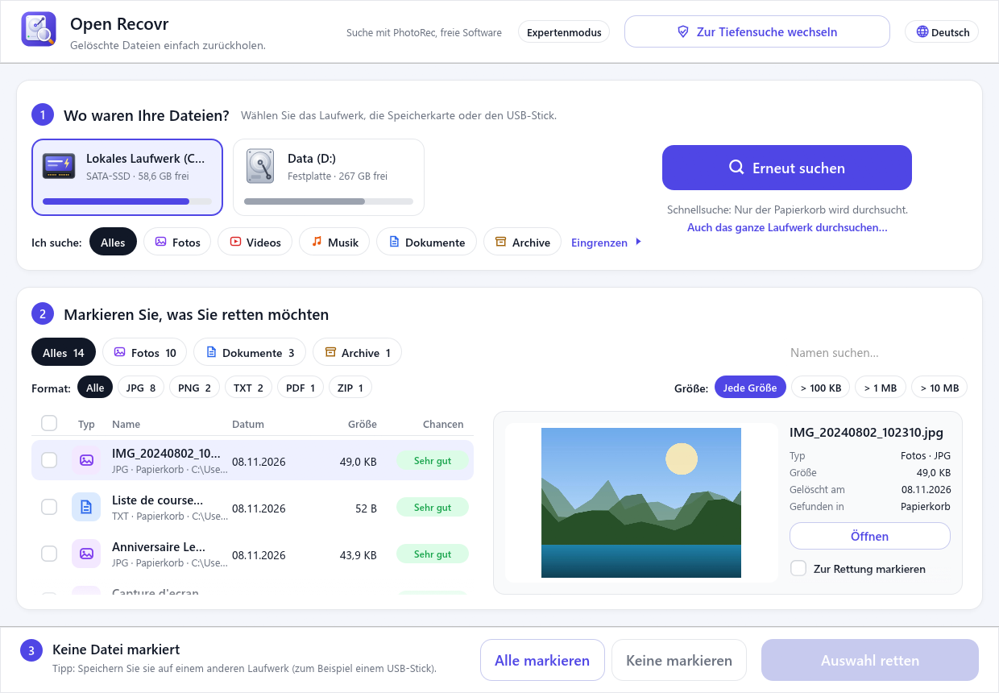
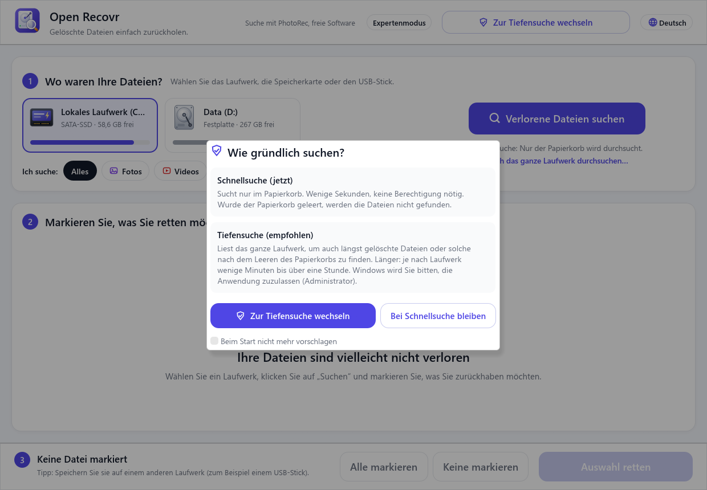
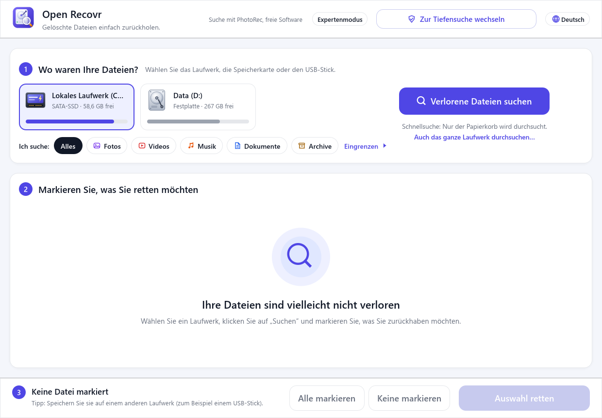
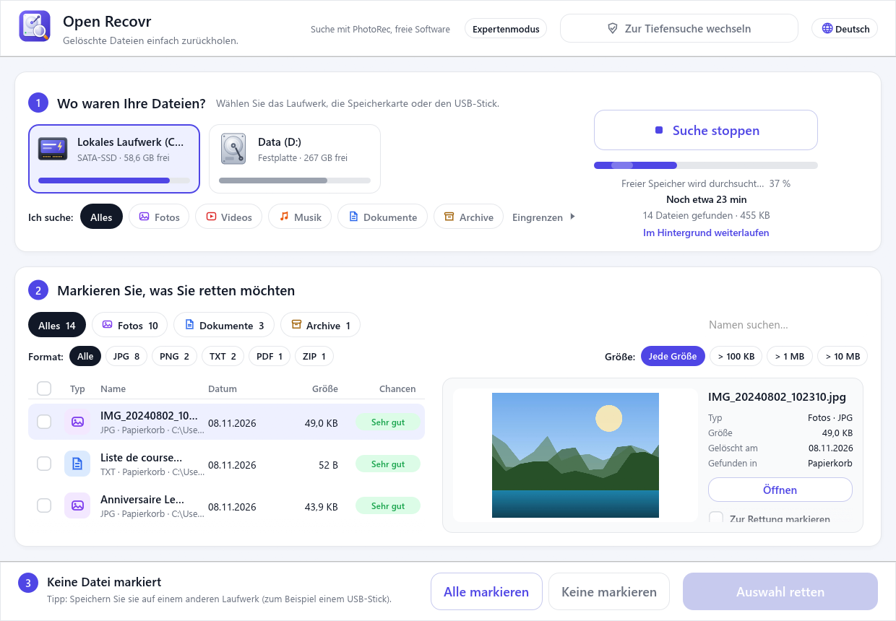
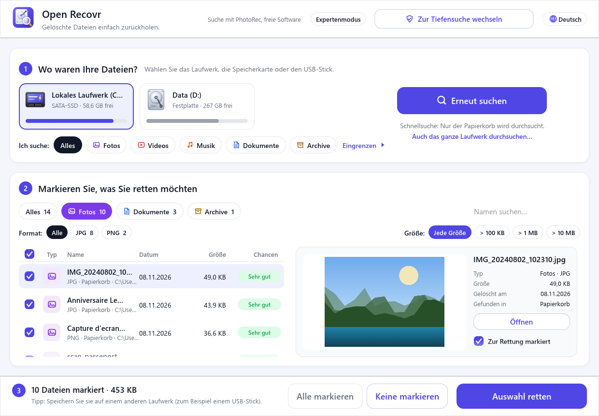
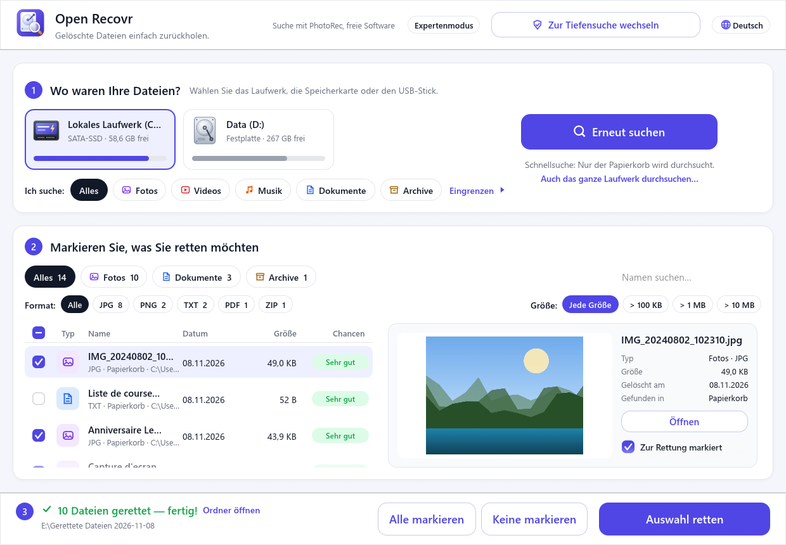

<div align="center">


# Open Recovr

**Gelöschte Dateien zurückholen, ganz einfach.**

Ein einziger Bildschirm, kein Assistent: Laufwerk wählen, suchen, ankreuzen, was zurück soll.<br>
Frei und kostenlos, angetrieben von [PhotoRec](https://www.cgsecurity.org/wiki/PhotoRec).

[English](README.md) · [Français](README.fr.md) · [Español](README.es.md) · **Deutsch**

[](https://github.com/jlerouge/open-recovr/actions/workflows/ci.yml)
[](https://github.com/jlerouge/open-recovr/releases/latest)
[](https://github.com/jlerouge/open-recovr/releases)
[](LICENSE)
[](https://www.rust-lang.org)
[](#unterstützte-systeme)



</div>

## Warum Open Recovr?

Den Urlaubsordner oder eine Abschlussarbeit zu verlieren, ist schon stressig genug. Wiederherstellungsprogramme sind oft teuer oder voller Fachjargon. Kostenlose Werkzeuge wie PhotoRec sind hervorragend, laufen aber in einem Textterminal.

Open Recovr setzt eine freundliche Oberfläche mit nur einem Bildschirm auf PhotoRec, eine bewährte freie Engine. Dazu kommt eine schnelle Analyse, die Dateien **mit ihrem ursprünglichen Namen und Ordner** zurückbringt.

## So funktioniert es

| 1. Schnell oder gründlich | 2. Laufwerk wählen | 3. Suchen |
|:---:|:---:|:---:|
| [](docs/screenshots/de-1-start.png) | [](docs/screenshots/de-2-home.png) | [](docs/screenshots/de-3-scanning.png) |
| Ein paar Sekunden im Papierkorb, oder das ganze Laufwerk. | Festplatte, SSD, Speicherkarte, USB-Stick, CD… | Dateien erscheinen, sobald sie gefunden werden, mit Restzeit. |

| 4. Durchsehen und Vorschau | 5. Ankreuzen | 6. Wiederherstellen |
|:---:|:---:|:---:|
| [](docs/screenshots/de-4-results.png) | [](docs/screenshots/de-5-selected.png) | [](docs/screenshots/de-6-recovered.png) |
| Filter nach Typ, Format, Größe oder Name. | Jede Datei zeigt ihre Chancen auf Wiederherstellung. | Kopie auf ein Laufwerk Ihrer Wahl. |

Die vollständige Anleitung finden Sie im **[Benutzerhandbuch](docs/user-guide.md)** (auf Englisch).

> [!WARNING]
> **Speichern Sie wiederhergestellte Dateien nie auf dem Laufwerk, von dem sie stammen.** Sie könnten Dateien überschreiben, die noch auf ihre Wiederherstellung warten. Ein USB-Stick oder eine andere Festplatte ist ideal. Open Recovr warnt Sie, wenn Sie es versuchen.

## Funktionen

- 🗑️ **Sofortsuche** im Papierkorb, in Sekunden und ohne besondere Rechte.
- 🔎 **Schnelle Analyse (NTFS).** Liest die Dateitabelle des Laufwerks (MFT), in der eine gelöschte Datei ihren Namen behält. Die Dateien kommen **mit Namen und Ordner** zurück, in wenigen Minuten, auch nach dem Leeren des Papierkorbs.
- 🧲 **Vollständige Analyse.** PhotoRec liest das ganze Laufwerk und erkennt **Hunderte von Dateitypen**, auch nach einer Formatierung oder auf FAT/exFAT-Karten. Ohne PhotoRec übernimmt eine eingebaute Engine die gängigen Formate.
- 💿 **Beschädigte Datenträger.** Unlesbare Bereiche (zerkratzte CD/DVD, abgenutzte Karten) werden übersprungen, statt die Suche zu blockieren.
- 🖼️ **Vorschau vor der Wiederherstellung.** Fotos, Videos, Töne, PDFs, Texte und Word-Dokumente.
- 🗂️ **Sortieren und filtern** nach Typ (Fotos, Videos, Musik, Dokumente, Archive), Format, Größe und Name.
- 💾 **Alle Laufwerke.** Festplatten, SATA- und NVMe-SSDs, SD-, microSD- und CompactFlash-Karten, USB-Sticks, externe Festplatten und CD/DVD.
- 🕒 **Im Hintergrund.** Das Fenster kann sich während einer langen Suche neben der Uhr verstecken.
- 🛠️ **Expertenmodus.** Das vollständige Suchprotokoll und die Ausgabe von PhotoRec.
- 🌍 **4 Sprachen:** Deutsch, Englisch, Französisch und Spanisch.
- 🔒 **Nur lesend.** Auf das durchsuchte Laufwerk wird nie etwas geschrieben. Kein Konto, keine Telemetrie, kein Internet nötig.

## Herunterladen

Laden Sie die neueste Version unter **[Releases](https://github.com/jlerouge/open-recovr/releases/latest)** herunter:

| System | Datei | So starten Sie es |
|---|---|---|
| **Windows 10 / 11** (64 Bit) | `open-recovr-…-windows-x64.zip` | Entpacken und `open-recovr.exe` öffnen. PhotoRec ist enthalten. |
| Linux (64 Bit) | `open-recovr-…-linux-x64.tar.gz` | Entpacken und `./open-recovr` starten. Für die vollständige Analyse: `sudo apt install testdisk`. |
| macOS (Apple Silicon / Intel) | `open-recovr-…-macos-arm64.tar.gz` / `…-macos-x64.tar.gz` | Entpacken, dann Rechtsklick → *Öffnen* (die App ist nicht signiert). Danach `brew install testdisk`. |

Das Laufwerk selbst zu lesen (schnelle und vollständige Analyse) erfordert Administratorrechte. Open Recovr fragt nur danach, wenn Sie zur gründlichen Suche wechseln; der Papierkorb wird auch ohne sie durchsucht.

## Unterstützte Systeme

| | Windows | Linux | macOS |
|---|:---:|:---:|:---:|
| In der CI gebaut | ✅ | ✅ | ✅ |
| Auf echter Hardware getestet | ✅ | ⚠️ noch nicht | ⚠️ noch nicht |
| Vollständige Analyse (PhotoRec) | ✅ enthalten | ✅ `apt install testdisk` | ✅ `brew install testdisk` |
| Video-/PDF-Vorschaubilder, Ton | ✅ | ❌ | ❌ |

**Windows ist die wichtigste und getestete Plattform.** Die Versionen für Linux und macOS lassen sich bauen, wurden aber noch auf keiner echten Hardware getestet. Rückmeldungen und Korrekturen sind sehr willkommen, siehe [CONTRIBUTING.md](CONTRIBUTING.md).

## Selbst bauen

Sie benötigen [Rust](https://rustup.rs) 1.95 oder neuer.

```sh
git clone https://github.com/jlerouge/open-recovr
cd open-recovr
cargo build --release
```

Unter Windows laden Sie PhotoRec einmalig mit `powershell -ExecutionPolicy Bypass -File scripts\fetch-photorec.ps1` herunter. Die Kommandozeilenoptionen sind im [englischen README](README.md#build-from-source) beschrieben.

## Lizenz und Danksagung

Open Recovr ist freie Software unter der [MIT-Lizenz](LICENSE).

Die vollständige Analyse übernimmt **[PhotoRec](https://www.cgsecurity.org/wiki/PhotoRec)** © Christophe Grenier, lizenziert unter der GNU GPL v2 oder später. Open Recovr startet es als **separates, unverändertes Programm**. Die Windows-Version enthält PhotoRec 7.2 samt Lizenz (`vendor/testdisk-7.2/COPYING.txt`). Der Quellcode von PhotoRec ist auf [cgsecurity.org](https://www.cgsecurity.org/wiki/TestDisk_Download) erhältlich.

Open Recovr ist ein unabhängiges Projekt und steht in keiner Verbindung zu kommerzieller Wiederherstellungssoftware.

## Sternverlauf

<a href="https://star-history.com/#jlerouge/open-recovr&Date">
  <picture>
    <source media="(prefers-color-scheme: dark)" srcset="https://api.star-history.com/svg?repos=jlerouge/open-recovr&type=Date&theme=dark">
    
  </picture>
</a>
