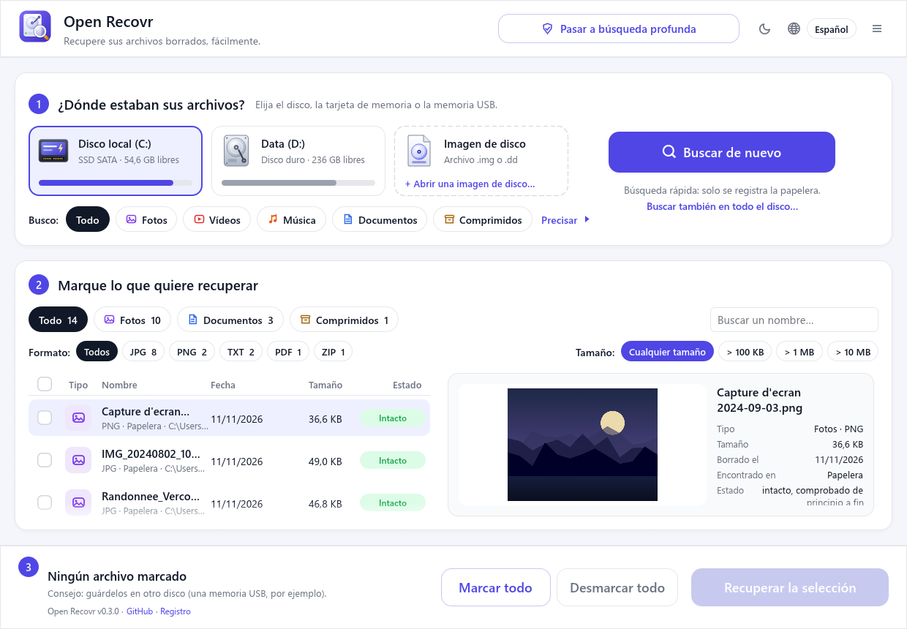
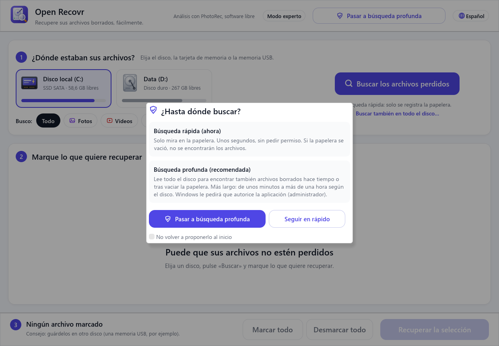
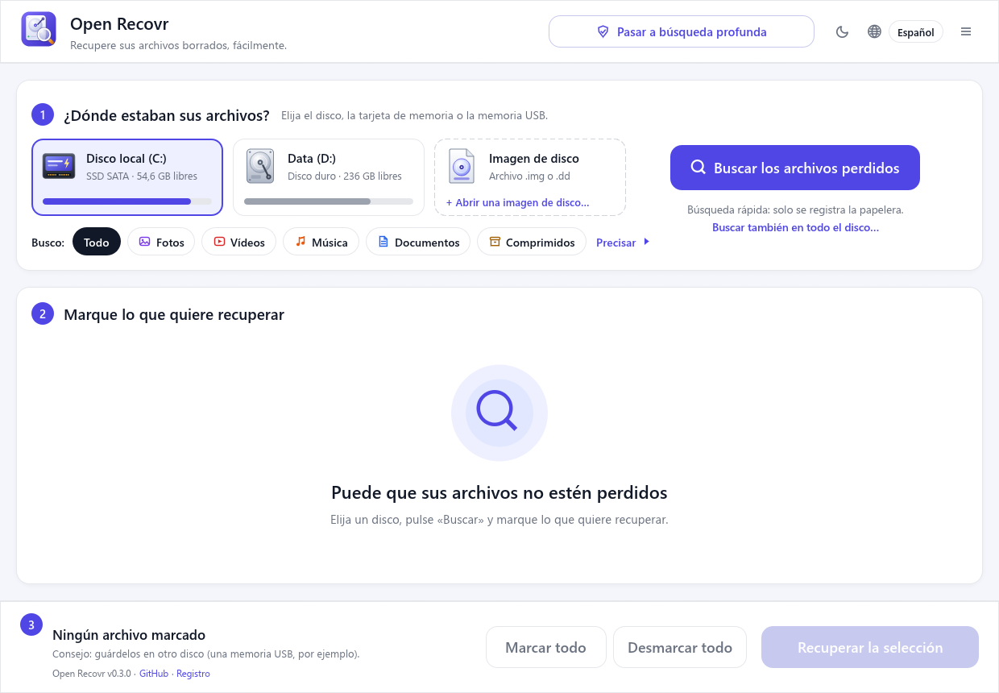
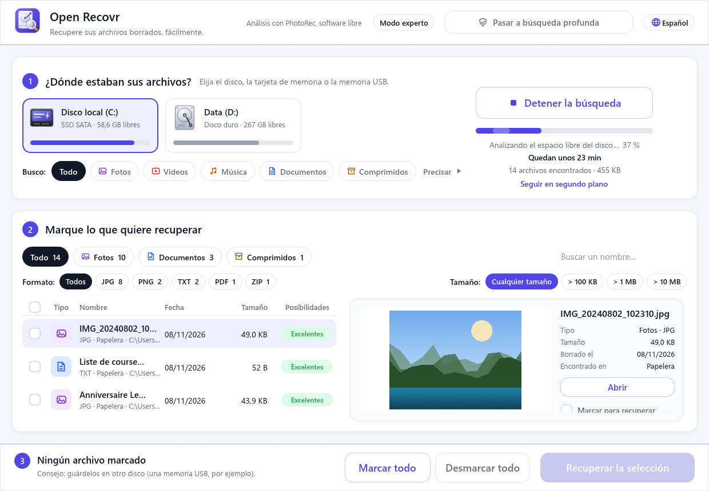
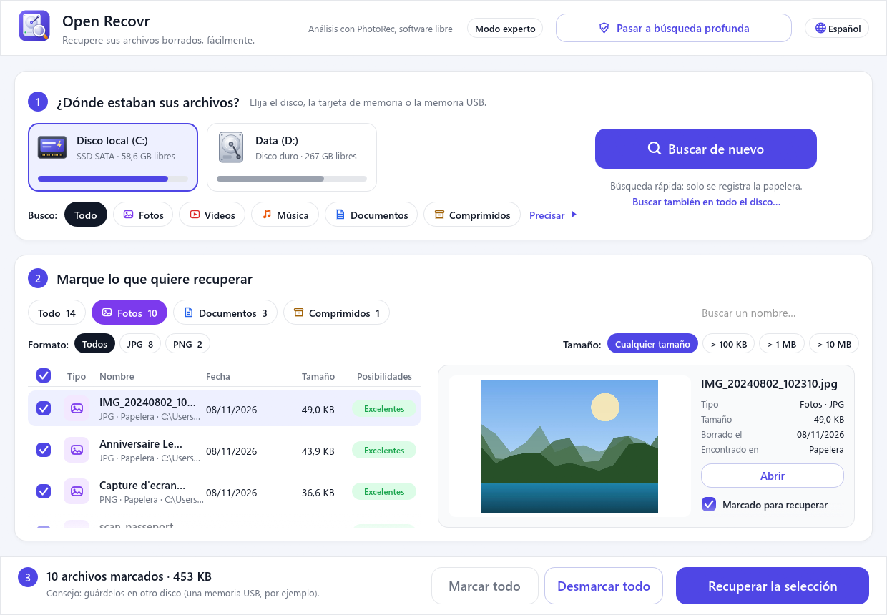
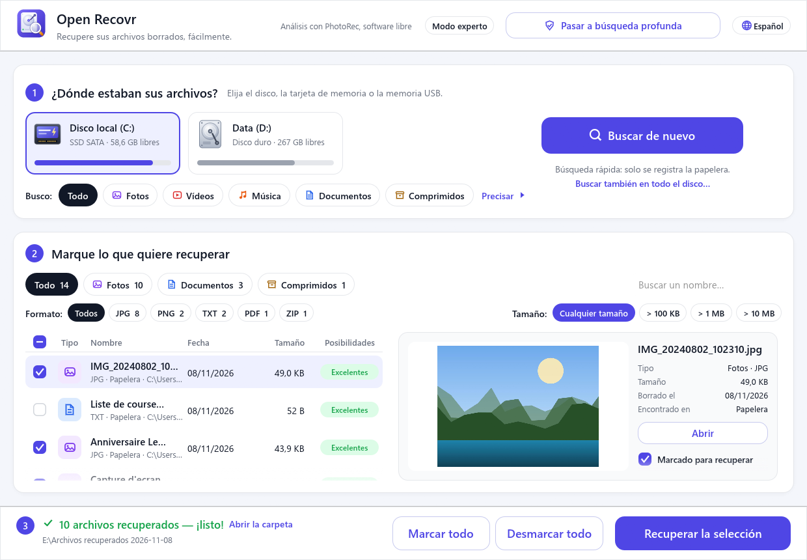

<div align="center">


# Open Recovr

**Recupera tus archivos borrados, de forma sencilla.**

Una sola pantalla, sin asistente: elige la unidad, busca y marca lo que quieres recuperar.<br>
Libre y gratuito, con [PhotoRec](https://www.cgsecurity.org/wiki/PhotoRec) como motor.

[English](README.md) · [Français](README.fr.md) · **Español** · [Deutsch](README.de.md)

[](https://github.com/jlerouge/open-recovr/actions/workflows/ci.yml)
[](https://github.com/jlerouge/open-recovr/releases/latest)
[](https://github.com/jlerouge/open-recovr/releases)
[](LICENSE)
[](https://www.rust-lang.org)
[](#sistemas-compatibles)



</div>

## ¿Por qué Open Recovr?

Perder la carpeta de las vacaciones o una tesis ya es bastante estresante. Los programas de recuperación suelen ser caros o estar llenos de jerga. Los gratuitos, como PhotoRec, son excelentes, pero funcionan en un terminal de texto.

Open Recovr pone una interfaz amable, de una sola pantalla, sobre PhotoRec, un motor libre de eficacia probada. Además añade un análisis rápido que devuelve los archivos **con su nombre y su carpeta originales**.

## Cómo funciona

| 1. Rápida o profunda | 2. Elegir la unidad | 3. Buscar |
|:---:|:---:|:---:|
| [](docs/screenshots/es-1-start.png) | [](docs/screenshots/es-2-home.png) | [](docs/screenshots/es-3-scanning.png) |
| Unos segundos en la papelera, o toda la unidad. | Disco duro, SSD, tarjeta de memoria, memoria USB, CD… | Los archivos aparecen a medida que se encuentran, con el tiempo restante. |

| 4. Explorar y previsualizar | 5. Marcar | 6. Recuperar |
|:---:|:---:|:---:|
| [](docs/screenshots/es-4-results.png) | [](docs/screenshots/es-5-selected.png) | [](docs/screenshots/es-6-recovered.png) |
| Filtros por tipo, formato, tamaño o nombre. | Cada archivo muestra sus posibilidades de recuperación. | Se copian en la unidad que elijas. |

La guía paso a paso completa está en la **[guía de uso](docs/user-guide.md)** (en inglés).

> [!WARNING]
> **Nunca guardes los archivos recuperados en la unidad de la que provienen.** Podrías sobrescribir los que aún esperan ser recuperados. Una memoria USB u otro disco es perfecto. Open Recovr te avisa si lo intentas.

## Funciones

- 🗑️ **Búsqueda inmediata** en la papelera, en segundos y sin permisos especiales.
- 🔎 **Análisis rápido (NTFS).** Lee la tabla de archivos de la unidad (MFT), donde un archivo borrado conserva su nombre. Los archivos vuelven **con su nombre y su carpeta**, en minutos, incluso después de vaciar la papelera.
- 🧲 **Análisis completo.** PhotoRec lee toda la unidad y reconoce **cientos de tipos de archivo**, incluso tras un formateo o en tarjetas FAT/exFAT. Sin PhotoRec, un motor integrado se encarga de los formatos más comunes.
- 💿 **Soportes dañados.** Las zonas ilegibles (CD/DVD rayados, tarjetas gastadas) se saltan en lugar de bloquear la búsqueda.
- 🖼️ **Vista previa antes de recuperar.** Fotos, vídeos, sonidos, PDF, textos y documentos Word.
- 🗂️ **Orden y filtros** por tipo (fotos, vídeos, música, documentos, archivos comprimidos), formato, tamaño y nombre.
- 💾 **Todo tipo de unidades.** Discos duros, SSD SATA y NVMe, tarjetas SD, microSD y CompactFlash, memorias USB, discos externos y CD/DVD.
- 🕒 **En segundo plano.** La ventana puede ocultarse junto al reloj durante una búsqueda larga.
- 🛠️ **Modo experto.** El registro completo de la búsqueda y la salida de PhotoRec.
- 🌍 **4 idiomas:** español, inglés, francés y alemán.
- 🔒 **Solo lectura.** Nunca se escribe nada en la unidad analizada. Sin cuenta, sin telemetría y sin necesidad de Internet: la única conexión es la búsqueda de actualizaciones (el número de la última versión, pedido a GitHub), que se puede desactivar en Ajustes.

## Descargar

Descarga la última versión en **[Releases](https://github.com/jlerouge/open-recovr/releases/latest)**:

| Sistema | Archivo | Cómo iniciarlo |
|---|---|---|
| **Windows 10 / 11** (64 bits) | `open-recovr-…-windows-x64-setup.exe` o `…-windows-x64.zip` | Ejecuta el instalador (sin derechos de administrador), o descomprime y abre `open-recovr.exe`. PhotoRec está incluido. Ambos se actualizan con un clic. |
| Linux (64 bits) | `open-recovr-…-linux-x64.tar.gz` | Descomprime y ejecuta `./open-recovr`. Para el análisis completo: `sudo apt install testdisk`. |
| macOS (Apple Silicon / Intel) | `open-recovr-…-macos-arm64.tar.gz` / `…-macos-x64.tar.gz` | Descomprime, luego clic derecho → *Abrir* (la aplicación no está firmada). Después, `brew install testdisk`. |

Leer la propia unidad (análisis rápido y completo) requiere permisos de administrador. Open Recovr solo los pide cuando pasas a la búsqueda profunda; la papelera se revisa sin ellos.

## Sistemas compatibles

| | Windows | Linux | macOS |
|---|:---:|:---:|:---:|
| Compilado en CI | ✅ | ✅ | ✅ |
| Probado en un equipo real | ✅ | ⚠️ todavía no | ⚠️ todavía no |
| Análisis completo (PhotoRec) | ✅ incluido | ✅ `apt install testdisk` | ✅ `brew install testdisk` |
| Miniaturas de vídeo / PDF, sonido | ✅ | ❌ | ❌ |

**Windows es la plataforma principal y probada.** Las versiones para Linux y macOS compilan, pero nadie las ha probado aún en un equipo real. Los comentarios y las correcciones son bienvenidos: consulta [CONTRIBUTING.md](CONTRIBUTING.md).

## Compilar

Necesitas [Rust](https://rustup.rs) 1.95 o posterior.

```sh
git clone https://github.com/jlerouge/open-recovr
cd open-recovr
cargo build --release
```

En Windows, descarga PhotoRec una vez con `powershell -ExecutionPolicy Bypass -File scripts\fetch-photorec.ps1`. Las opciones de línea de comandos se describen en el [README en inglés](README.md#build-from-source).

## Licencia y créditos

Open Recovr es software libre bajo la [licencia MIT](LICENSE).

El análisis completo lo realiza **[PhotoRec](https://www.cgsecurity.org/wiki/PhotoRec)** © Christophe Grenier, bajo licencia GNU GPL v2 o posterior. Open Recovr lo ejecuta como un **programa independiente, sin modificarlo**. La versión para Windows incluye PhotoRec 7.2 con su licencia (`vendor/testdisk-7.2/COPYING.txt`). El código fuente de PhotoRec está disponible en [cgsecurity.org](https://www.cgsecurity.org/wiki/TestDisk_Download).

Open Recovr es un proyecto independiente, sin relación con ningún software comercial de recuperación.

## Historial de estrellas

<a href="https://star-history.com/#jlerouge/open-recovr&Date">
  <picture>
    <source media="(prefers-color-scheme: dark)" srcset="https://api.star-history.com/svg?repos=jlerouge/open-recovr&type=Date&theme=dark">
    
  </picture>
</a>
