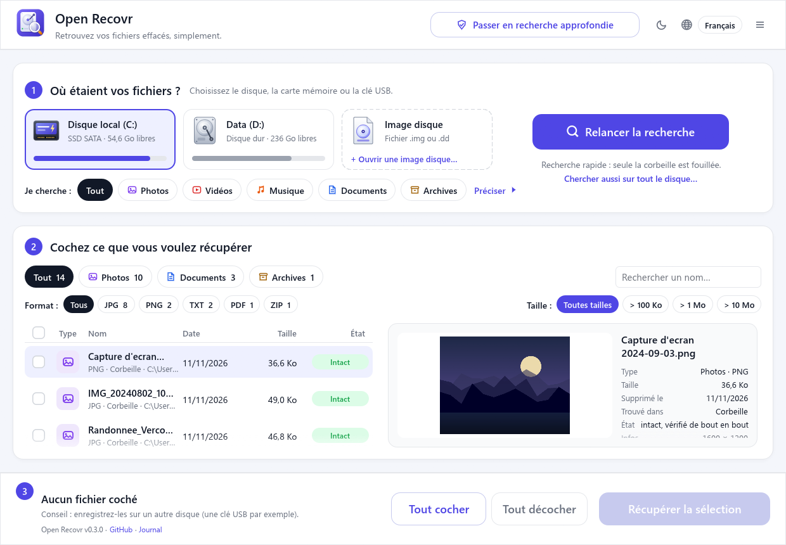
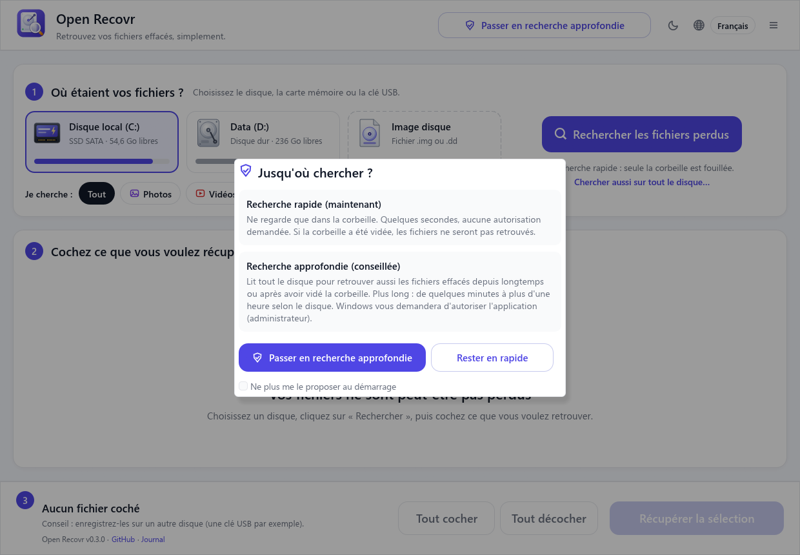
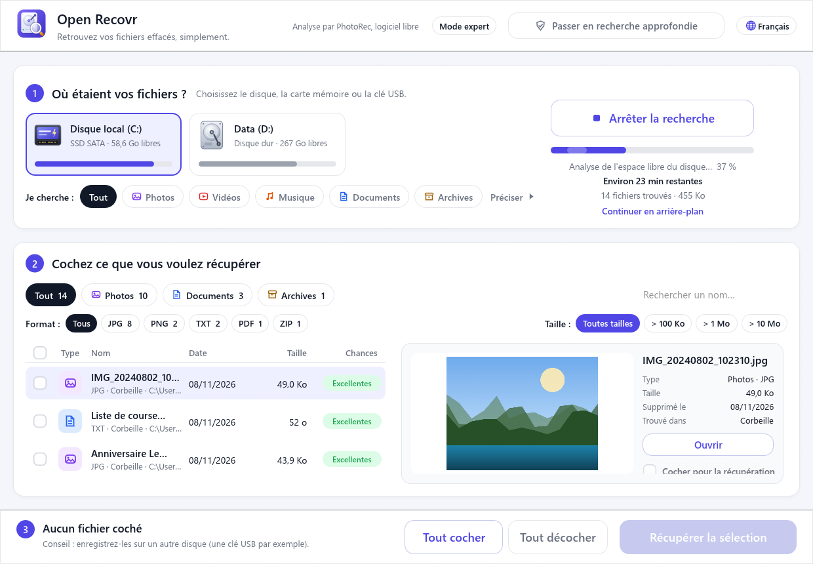
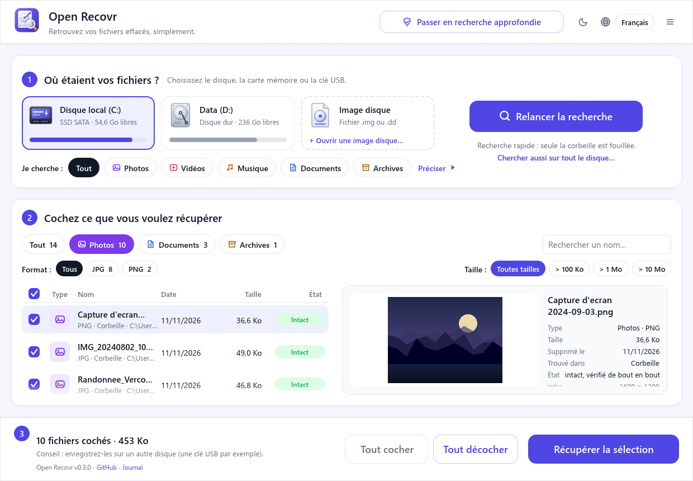
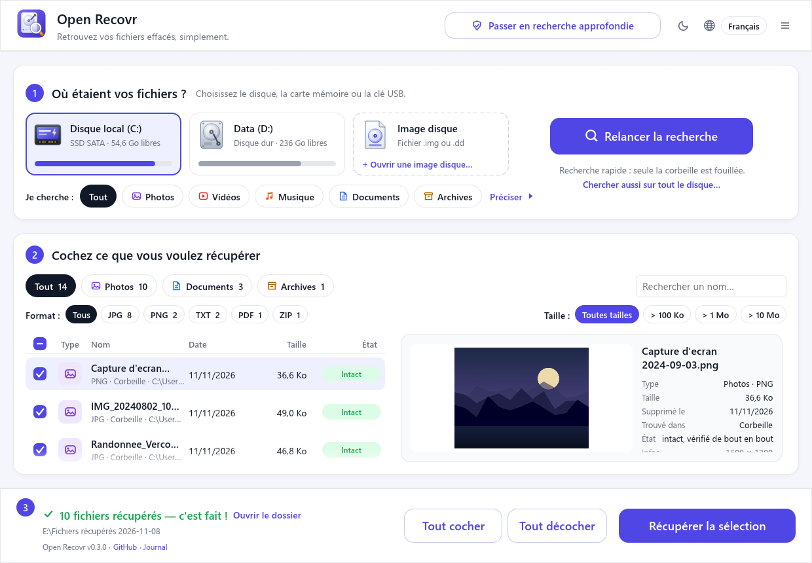
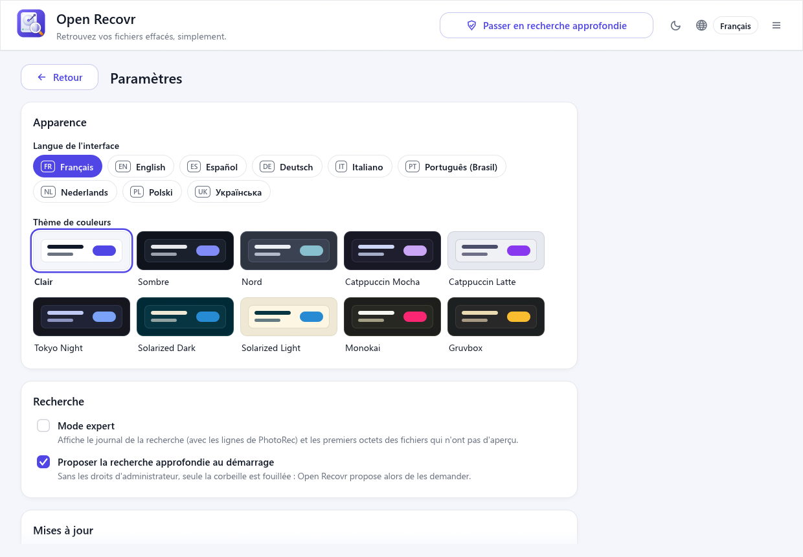
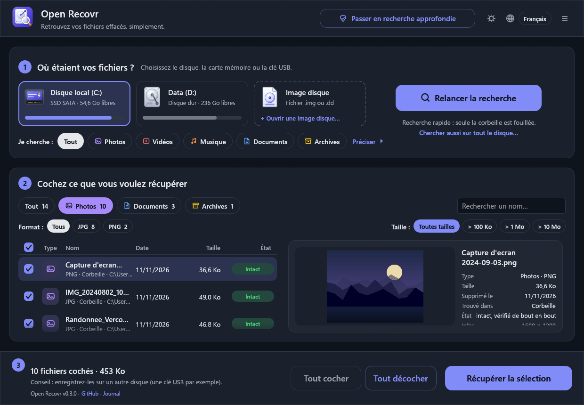
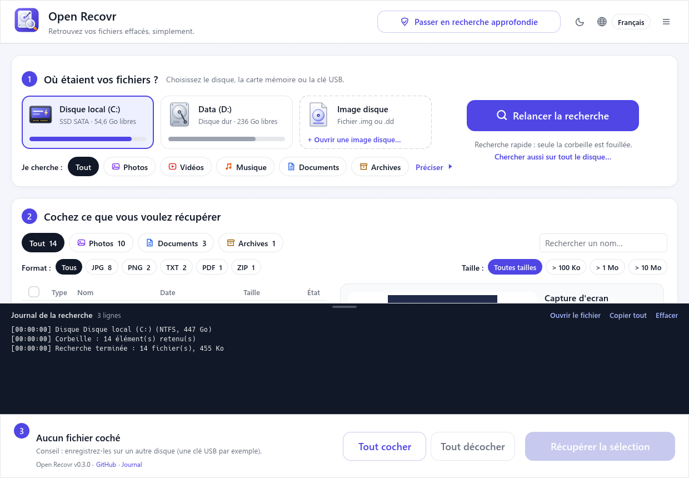

<div align="center">


# Open Recovr

**Retrouvez vos fichiers effacés, simplement.**

Un seul écran, pas d'assistant : on choisit le disque, on lance la recherche, on coche ce qu'on veut récupérer.<br>
Libre et gratuit, propulsé par [PhotoRec](https://www.cgsecurity.org/wiki/PhotoRec).

[English](README.md) · **Français** · [Español](README.es.md) · [Deutsch](README.de.md)

[](https://github.com/jlerouge/open-recovr/actions/workflows/ci.yml)
[](https://github.com/jlerouge/open-recovr/releases/latest)
[](https://github.com/jlerouge/open-recovr/releases)
[](LICENSE)
[](https://www.rust-lang.org)
[](#systèmes-pris-en-charge)



</div>

## Pourquoi Open Recovr ?

Perdre le dossier des vacances ou un mémoire, c'est déjà assez stressant. Les logiciels de récupération sont souvent chers ou pleins de jargon. Les gratuits comme PhotoRec sont excellents, mais s'utilisent dans un terminal en mode texte.

Open Recovr met une interface simple, en un seul écran, au-dessus de PhotoRec, un moteur libre qui a fait ses preuves. Il y ajoute une analyse rapide qui rend les fichiers **avec leur nom et leur dossier d'origine**.

## Comment ça marche

| 1. Rapide ou approfondie | 2. Choisir le disque | 3. Rechercher |
|:---:|:---:|:---:|
| [](docs/screenshots/fr-1-start.png) | [](docs/screenshots/fr-2-home.png) | [](docs/screenshots/fr-3-scanning.png) |
| Quelques secondes dans la corbeille, ou tout le disque. | Disque dur, SSD, carte mémoire, clé USB, CD… | Les fichiers s'affichent au fur et à mesure, avec le temps restant. |

| 4. Parcourir et prévisualiser | 5. Cocher | 6. Récupérer |
|:---:|:---:|:---:|
| [](docs/screenshots/fr-4-results.png) | [](docs/screenshots/fr-5-selected.png) | [](docs/screenshots/fr-6-recovered.png) |
| Filtres par type, format, taille ou nom. | Chaque fichier affiche ses chances de récupération. | Copie vers le disque de votre choix. |

| Paramètres | Thème sombre | Mode expert |
|:---:|:---:|:---:|
| [](docs/screenshots/fr-8-settings.png) | [](docs/screenshots/fr-9-dark.png) | [](docs/screenshots/fr-7-expert.png) |
| Langue, thème de couleurs, mises à jour, rapport. | Clair, sombre et 8 autres thèmes. | Le journal de la recherche, pour les curieux. |

Le pas-à-pas complet se trouve dans le **[guide d'utilisation](docs/user-guide.md)** (en anglais).

> [!WARNING]
> **N'enregistrez jamais les fichiers retrouvés sur le disque d'où ils viennent.** Vous pourriez écraser ceux qui attendent encore d'être récupérés. Une clé USB ou un autre disque fait très bien l'affaire. Open Recovr vous prévient si vous essayez.

## Ce qu'il sait faire

- 🗑️ **Recherche immédiate** dans la corbeille, en quelques secondes, sans droits particuliers.
- 🔎 **Analyse rapide (NTFS).** Lit la table des fichiers du disque (MFT). Un fichier effacé y garde son nom tant que la place n'est pas réutilisée. Les fichiers reviennent **avec leur nom et leur dossier**, en quelques minutes, même après avoir vidé la corbeille.
- 🧲 **Analyse complète.** Tout le disque est lu par PhotoRec, qui reconnaît **des centaines de types de fichiers**, même après un formatage ou sur une carte FAT/exFAT. Sans PhotoRec, un moteur intégré prend le relais pour les formats courants.
- 💿 **Supports abîmés.** Les zones illisibles (CD/DVD rayés, cartes usées) sont sautées au lieu de tout bloquer.
- 🖼️ **Aperçu avant de récupérer.** Photos, vidéos, sons, PDF, textes et documents Word.
- 🏷️ **Des noms et des dates qui parlent.** Un fichier qui n'avait qu'un numéro reçoit un nom tiré de son contenu : `photo_2024-07-14_18-22-05.jpg` d'après la date EXIF, le titre d'un document Word ou PDF, l'artiste et le titre d'un MP3.
- ✅ **Vérifié avant de récupérer.** Chaque fichier retrouvé est lu de bout en bout : **Intact**, **Abîmé** (avec la raison : coupé, mélangé à un autre fichier, index manquant…) ou **Vide**.
- 👯 **Doublons masqués.** Un même fichier retrouvé plusieurs fois n'est affiché qu'une fois.
- 📀 **Images disque.** Ouvre une copie `.img` / `.dd` d'un disque fatigué (faite avec ddrescue, par exemple) pour ne pas toucher à l'original. Sans droits administrateur.
- 🗂️ **Tri et filtres** par type (photos, vidéos, musique, documents, archives), format, taille et nom.
- 💾 **Tous les supports.** Disques durs, SSD SATA et NVMe, cartes SD, microSD et CompactFlash, clés USB, disques externes, CD/DVD.
- 🕒 **En arrière-plan.** La fenêtre peut se ranger près de l'horloge pendant une longue recherche.
- 🛠️ **Mode expert.** Le journal complet de la recherche et les lignes de PhotoRec.
- 🎨 **Thèmes de couleurs.** Clair ou sombre en un clic, et aussi Nord, Catppuccin, Tokyo Night, Solarized, Monokai et Gruvbox.
- 🔄 **Mises à jour sûres.** Quand une nouvelle version sort, un clic la télécharge, vérifie sa signature et l'installe.
- 🩺 **Rapport d'aide.** *Préparer un rapport…* enregistre un zip (système, disques, journal de la dernière recherche) à envoyer à la personne qui vous aide, avec les noms personnels masqués. Open Recovr ne l'envoie jamais lui-même.
- 🌍 **9 langues :** français, anglais, espagnol, allemand, italien, portugais du Brésil, néerlandais, polonais, ukrainien.
- 🔒 **Lecture seule.** Rien n'est jamais écrit sur le disque fouillé. Pas de compte, pas de télémétrie, pas besoin d'Internet : la seule connexion est la recherche de mises à jour (le numéro de la dernière version, demandé à GitHub), désactivable dans les Paramètres.

Un téléphone branché en USB ne peut pas être fouillé : il ne montre que les fichiers encore présents, et sa mémoire est chiffrée. L'application explique où chercher à la place : la corbeille de l'appli Galerie ou Photos, Google Photos, iCloud ou la carte microSD.

## Télécharger

Prenez la dernière version dans **[Releases](https://github.com/jlerouge/open-recovr/releases/latest)** :

| Système | Fichier | Comment le lancer |
|---|---|---|
| **Windows 10 / 11** (64 bits) | `open-recovr-…-windows-x64-setup.exe` ou `…-windows-x64.zip` | Lancez l'installeur (sans droits d'administrateur), ou décompressez et ouvrez `open-recovr.exe`. PhotoRec est inclus. Les deux se mettent à jour en un clic. |
| Linux (64 bits) | `open-recovr-…-linux-x64.tar.gz` | Décompressez, puis lancez `./open-recovr`. Pour l'analyse complète : `sudo apt install testdisk`. |
| macOS (Apple Silicon / Intel) | `open-recovr-…-macos-arm64.tar.gz` / `…-macos-x64.tar.gz` | Décompressez, puis clic droit → *Ouvrir* (l'application n'est pas signée). Puis `brew install testdisk`. |

Lire le disque lui-même (analyse rapide et analyse complète) demande les droits administrateur. Open Recovr ne les demande que si vous passez en recherche approfondie ; la corbeille, elle, se fouille sans.

## Systèmes pris en charge

| | Windows | Linux | macOS |
|---|:---:|:---:|:---:|
| Compilé par la CI | ✅ | ✅ | ✅ |
| Testé sur une vraie machine | ✅ | ⚠️ pas encore | ⚠️ pas encore |
| Corbeille | ✅ | ✅ corbeille freedesktop | ✅ `.Trash` |
| Table des fichiers NTFS (analyse rapide) | ✅ | ✅ volumes NTFS | ✅ volumes NTFS |
| Analyse complète (PhotoRec) | ✅ inclus | ✅ `apt install testdisk` | ✅ `brew install testdisk` |
| Vignettes vidéo / PDF, lecture des sons | ✅ | ❌ | ❌ |
| Icône près de l'horloge | ✅ | ❌ | ❌ |

**Windows est la plateforme principale et testée.** Les versions Linux et macOS compilent, et leur code système est écrit, mais personne ne les a encore essayées sur une vraie machine. Retours et corrections bienvenus : voir [CONTRIBUTING.md](CONTRIBUTING.md).

## Compiler soi-même

Il faut [Rust](https://rustup.rs) 1.95 ou plus récent.

```sh
git clone https://github.com/jlerouge/open-recovr
cd open-recovr
cargo build --release
```

Le programme se trouve dans `target/release/`. Sous Windows, récupérez PhotoRec une fois pour toutes :

```powershell
powershell -ExecutionPolicy Bypass -File scripts\fetch-photorec.ps1
```

Les options en ligne de commande (`--lang`, `--theme`, `--disk`, `--image`, `--search`, `--expert`, `--screenshot`, `--scene`, `--bench`) sont décrites dans le [README anglais](README.md#build-from-source).

## Documentation

- 📖 [Guide d'utilisation](docs/user-guide.md) : chaque étape, avec conseils et FAQ (en anglais)
- 🏗️ [Architecture](docs/architecture.md) : organisation du code et fonctionnement de chaque recherche (en anglais)
- 🤝 [Contribuer](CONTRIBUTING.md) : compiler, tester, traduire. Les contributions assistées par IA sont acceptées.
- 📝 [Changements](CHANGELOG.md)

## Licence et remerciements

Open Recovr est un logiciel libre sous [licence MIT](LICENSE).

L'analyse complète est faite par **[PhotoRec](https://www.cgsecurity.org/wiki/PhotoRec)** © Christophe Grenier, sous licence GNU GPL v2 ou ultérieure. Open Recovr le lance comme un **programme séparé, sans le modifier**. La version Windows inclut PhotoRec 7.2, ses bibliothèques Cygwin et sa licence (`vendor/testdisk-7.2/COPYING.txt`). Le code source de PhotoRec est disponible sur [cgsecurity.org](https://www.cgsecurity.org/wiki/TestDisk_Download). Merci Christophe pour plus de vingt ans de travail sur TestDisk et PhotoRec.

Open Recovr est un projet indépendant, sans lien avec aucun logiciel de récupération commercial.

## Historique des étoiles

<a href="https://star-history.com/#jlerouge/open-recovr&Date">
  <picture>
    <source media="(prefers-color-scheme: dark)" srcset="https://api.star-history.com/svg?repos=jlerouge/open-recovr&type=Date&theme=dark">
    
  </picture>
</a>
