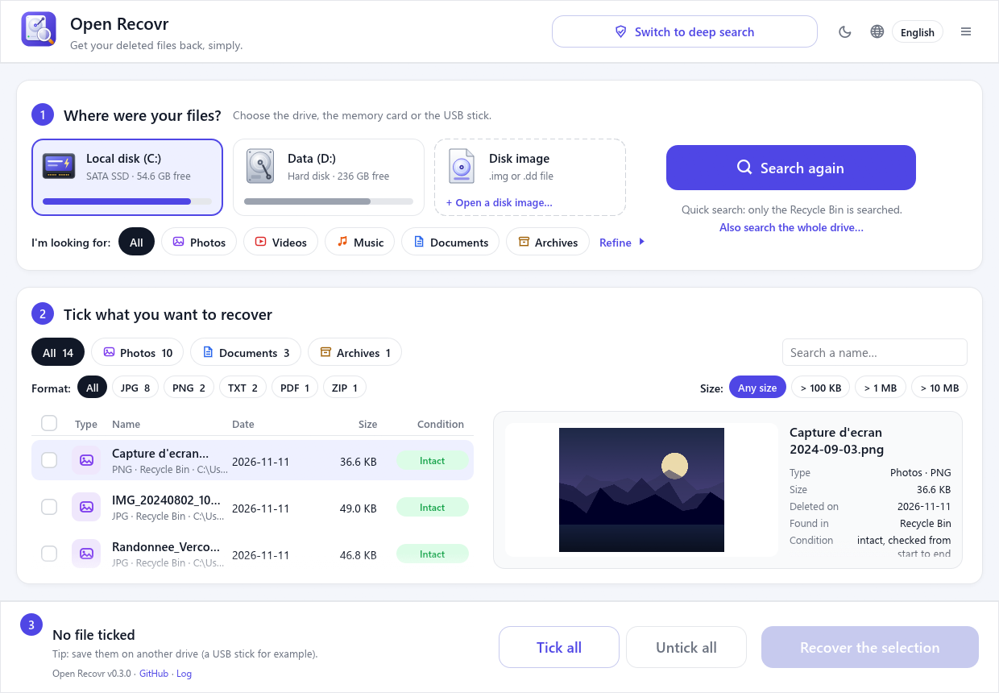
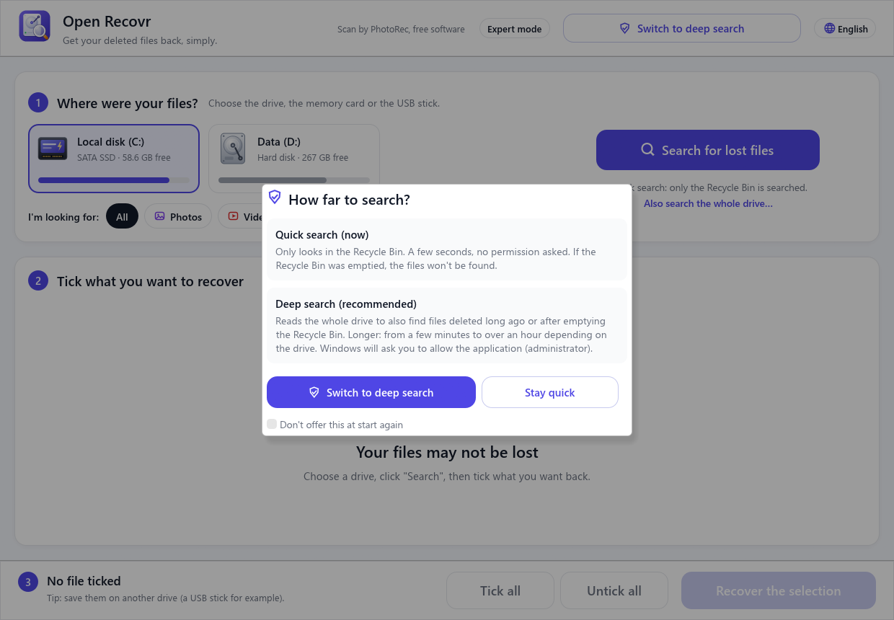
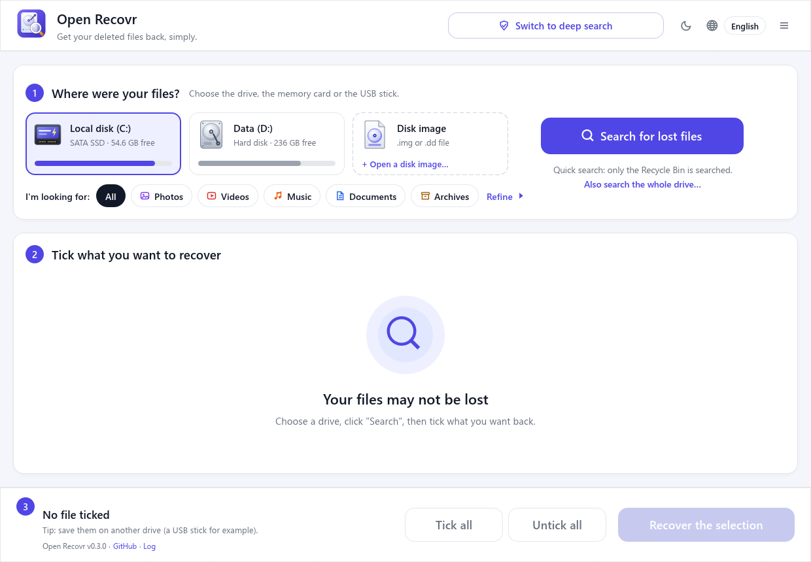
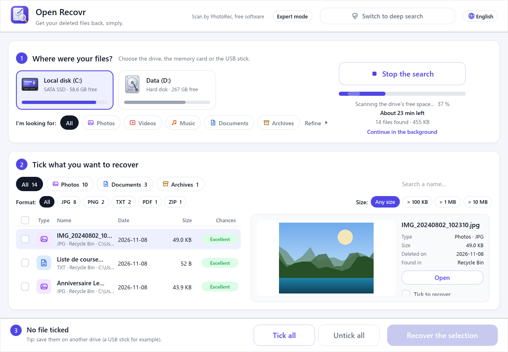
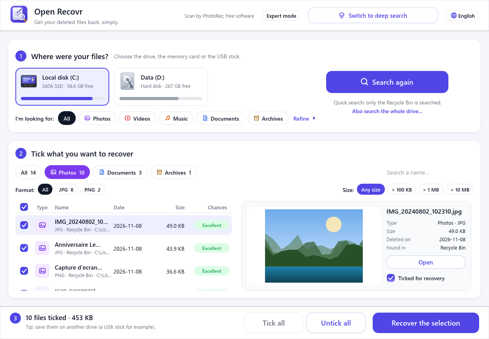
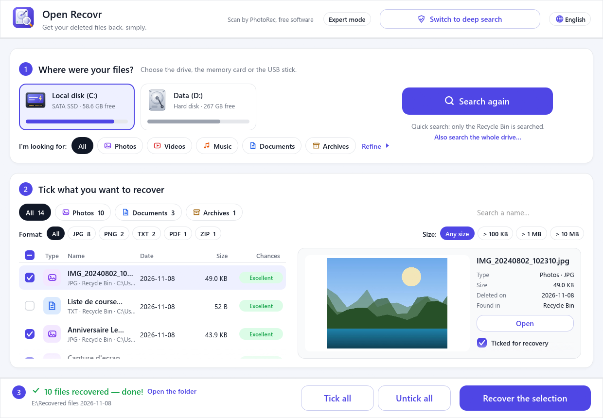
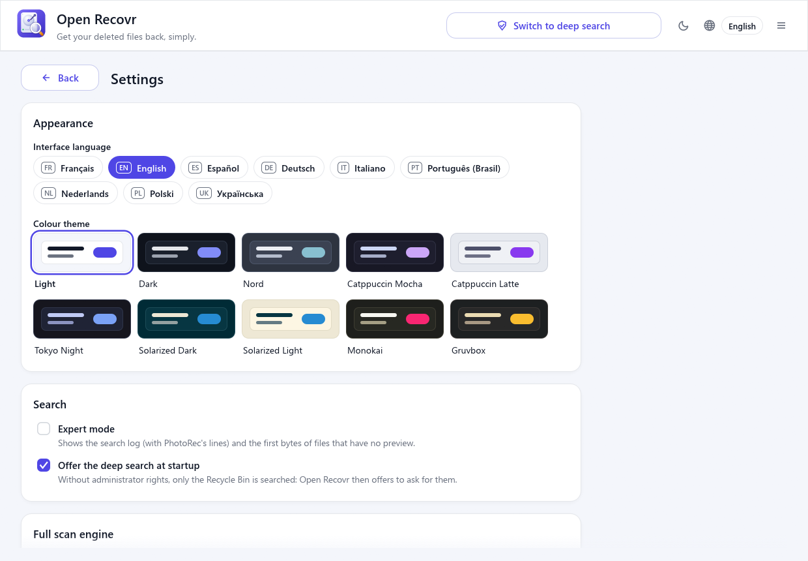
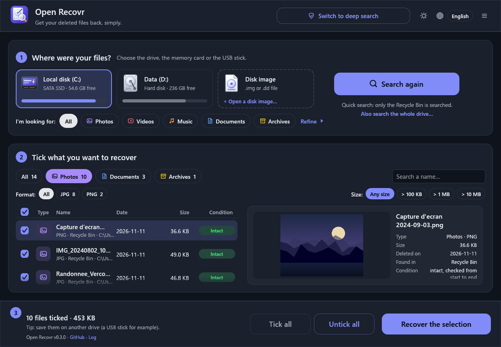
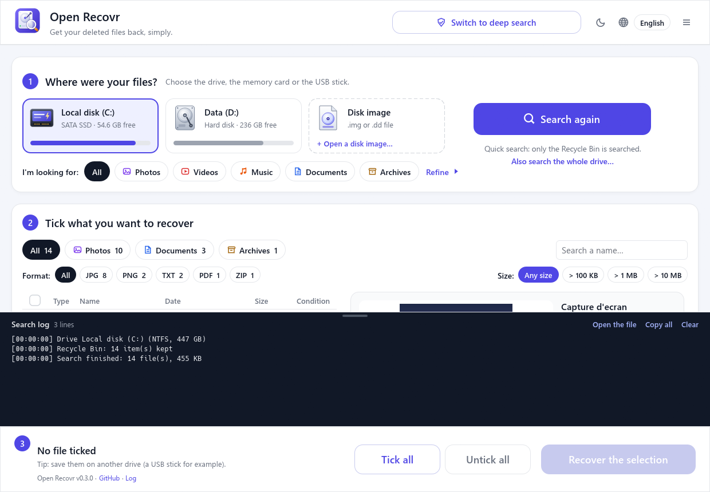
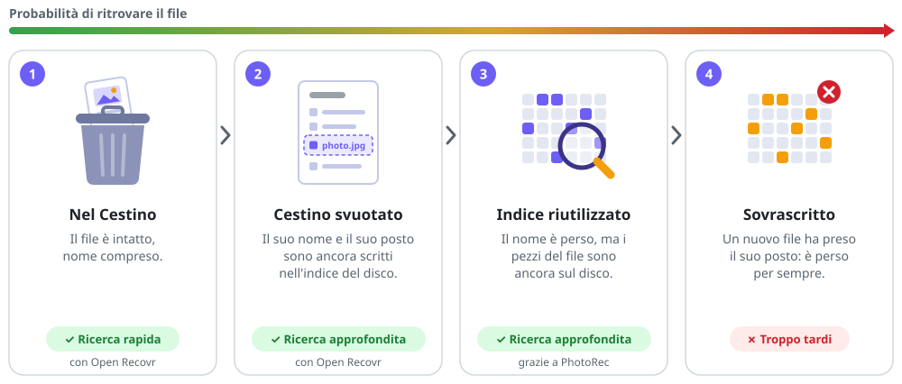

<div align="center">


**Recupera i tuoi file eliminati, in modo semplice.**

Una sola schermata, nessuna procedura guidata: scegli l'unità, cerca, seleziona ciò che vuoi recuperare.<br>
Libero e gratuito, con un proprio motore di recupero e [PhotoRec](https://www.cgsecurity.org/wiki/PhotoRec) come opzione.

[English](README.md) · [Français](README.fr.md) · [Español](README.es.md) · [Deutsch](README.de.md) · **Italiano** · [Português (Brasil)](README.pt.md) · [Nederlands](README.nl.md) · [Polski](README.pl.md) · [Українська](README.uk.md)

[](https://github.com/jlerouge/open-recovr/actions/workflows/ci.yml)
[](https://github.com/jlerouge/open-recovr/releases/latest)
[](https://github.com/jlerouge/open-recovr/releases)
[](LICENSE)
[](https://www.rust-lang.org)
[](#sistemi-supportati)
[](https://stand-with-ukraine.pp.ua)



</div>

> [!NOTE]
> Questa pagina è una traduzione automatica e le schermate sono in inglese. Le correzioni di un madrelingua sono benvenute: vedi [CONTRIBUTING.md](CONTRIBUTING.md).

## Perché Open Recovr?

Perdere la cartella delle vacanze o una tesi è già abbastanza stressante. I programmi di recupero sono spesso costosi o pieni di gergo tecnico. Quelli gratuiti, come PhotoRec, sono eccellenti ma funzionano in un terminale di testo.

Open Recovr riunisce tutto in una sola schermata semplice. Un'analisi veloce restituisce i file **con il loro nome e la loro cartella originali**. Per il resto, il suo motore legge tutta l'unità e **ricompone foto, archivi e documenti Office frammentati**. PhotoRec, il motore libero collaudato, resta disponibile come motore classico. Il confronto tra i due è misurato nei [benchmark](docs/benchmarks.md) (in inglese).

## Come funziona

| 1. Rapida o approfondita | 2. Scegli l'unità | 3. Cerca |
|:---:|:---:|:---:|
| [](docs/screenshots/en-1-start.png) | [](docs/screenshots/en-2-home.png) | [](docs/screenshots/en-3-scanning.png) |
| Pochi secondi nel Cestino, oppure tutta l'unità. | Disco rigido, SSD, scheda di memoria, chiavetta USB, CD… | I file compaiono man mano che vengono trovati, con il tempo rimanente. |

| 4. Sfoglia e visualizza | 5. Seleziona | 6. Recupera |
|:---:|:---:|:---:|
| [](docs/screenshots/en-4-results.png) | [](docs/screenshots/en-5-selected.png) | [](docs/screenshots/en-6-recovered.png) |
| Filtri per tipo, formato, dimensione o nome. | Ogni file mostra se è integro. | Copiati sull'unità che scegli. |

| Impostazioni | Tema scuro | Modalità esperto |
|:---:|:---:|:---:|
| [](docs/screenshots/en-8-settings.png) | [](docs/screenshots/en-9-dark.png) | [](docs/screenshots/en-7-expert.png) |
| Lingua, tema dei colori, aggiornamenti, rapporto. | Chiaro, scuro e altri 8 temi. | Il registro della ricerca, per i curiosi. |

La procedura completa, passo per passo, è nella **[guida all'uso](docs/user-guide.it.md)**.

## Dove finiscono i file eliminati?

Eliminare un file non lo cancella. Il sistema dimentica solo dove si trova e segna il suo spazio come libero. Il contenuto resta sul disco finché qualcosa di nuovo non ci viene scritto sopra. Ogni ricerca scende di un gradino:

<picture>
  <source media="(prefers-color-scheme: dark)" srcset="docs/illustrations/deleted-file-it-dark.svg">
  
</picture>

Al passo 3 restano solo i byte. Il **file carving** scorre tutto il disco cercando le firme che segnano l'inizio di ogni tipo di file, e stabilisce dove finisce ogni file. Quando un file era salvato in più pezzi, il pezzo successivo viene cercato nello spazio libero. Il motore moderno di Open Recovr lo fa da sé ([come](docs/carving.md), in inglese). Il motore classico affida questo lavoro a **[PhotoRec](https://www.cgsecurity.org/wiki/PhotoRec)**, che riconosce molti più tipi di file. PhotoRec ha posto basi solide per questo genere di software open source: un grande grazie a Christophe Grenier, che lo scrive e lo mantiene da oltre vent'anni.

Prima cerchi, più c'è da trovare. Su un SSD lo spazio liberato viene spesso cancellato in background poco dopo (TRIM): i passi 1 e 2 funzionano ancora per le eliminazioni recenti, ma l'analisi completa potrebbe trovare poco.

> [!WARNING]
> **Non salvare mai i file recuperati sull'unità da cui provengono.** Potresti sovrascrivere quelli che aspettano ancora di essere recuperati. Una chiavetta USB o un altro disco vanno benissimo. Open Recovr ti avvisa se ci provi.

> [!CAUTION]
> **Un'unità che si sta guastando (ticchettii, grande lentezza, errori di lettura) può peggiorare a ogni lettura.** Smetti di usarla e copiala prima per intero su un disco sano con uno strumento come [ddrescue](https://www.gnu.org/software/ddrescue/). Poi apri quella copia con *Apri un'immagine disco…* e cercaci dentro tutte le volte che vuoi, senza toccare l'originale.

## Funzioni

- 🗑️ **Ricerca rapida** nel Cestino, in pochi secondi e senza permessi particolari.
- 🔎 **Analisi rapida (NTFS).** Legge la tabella dei file dell'unità (MFT), dove un file eliminato conserva il suo nome. I file tornano **con il loro nome e la loro cartella**, in pochi minuti, anche dopo aver svuotato il Cestino.
- 🧲 **Analisi completa.** Tutta l'unità viene letta e i file sono riconosciuti dal loro contenuto, anche dopo una formattazione o su schede FAT/exFAT. Il **motore moderno**, quello di Open Recovr, riconosce una quarantina di formati (foto, RAW, video, musica, Office, PDF, archivi, font) e **ricompone i file frammentati**. Il **motore classico**, PhotoRec, riconosce **centinaia di tipi di file**; si sceglie nelle Impostazioni.
- 💿 **Supporti danneggiati.** Le zone illeggibili (CD/DVD graffiati, schede usurate) vengono saltate invece di bloccare la ricerca.
- 🖼️ **Anteprima prima del recupero.** Foto, video, suoni, PDF, testi e documenti Word.
- 🏷️ **Nomi e date sensati.** Un file che aveva solo un numero riceve un nome tratto dal suo contenuto: `photo_2024-07-14_18-22-05.jpg` dalla data EXIF, il titolo di un documento Word o PDF, l'artista e il brano di un MP3.
- ✅ **Controllato prima del recupero.** Ogni file trovato viene letto dall'inizio alla fine: **Integro**, **Danneggiato** (con il motivo: troncato, mescolato con un altro file, indice mancante…) o **Vuoto**.
- 👯 **Duplicati nascosti.** Lo stesso file trovato più volte viene mostrato una sola volta.
- 📀 **Immagini disco.** Apre una copia `.img` / `.dd` di un'unità che si sta guastando (fatta con ddrescue, per esempio), per non toccare l'originale. Senza diritti di amministratore.
- 🗂️ **Ordinamento e filtri** per tipo (foto, video, musica, documenti, archivi), formato, dimensione e nome.
- 💾 **Ogni tipo di unità.** Dischi rigidi, SSD SATA e NVMe, schede SD, microSD e CompactFlash, chiavette USB, dischi esterni, CD/DVD.
- 🕒 **In background.** La finestra può nascondersi accanto all'orologio durante una ricerca lunga.
- 🛠️ **Modalità esperto.** Il registro completo della ricerca (e l'output di PhotoRec con il motore classico).
- 🎨 **Temi dei colori.** Chiaro o scuro con un clic, e anche Nord, Catppuccin, Tokyo Night, Solarized, Monokai e Gruvbox.
- 🔄 **Aggiornamenti sicuri.** Quando esce una nuova versione, un clic la scarica, ne verifica la firma e la installa.
- 🩺 **Rapporto di aiuto.** *Prepara un rapporto…* salva uno zip (sistema, unità, registro dell'ultima ricerca) da inviare a chi ti aiuta, con i nomi personali mascherati. Open Recovr non lo invia mai da solo.
- 🌍 **9 lingue:** italiano, inglese, francese, spagnolo, tedesco, portoghese brasiliano, olandese, polacco e ucraino.
- 🔒 **Sola lettura.** Sull'unità analizzata non viene mai scritto nulla. Nessun account, nessuna telemetria, nessun bisogno di Internet: l'unica connessione è la ricerca di aggiornamenti (il numero dell'ultima versione, chiesto a GitHub), che si può disattivare nelle Impostazioni.

Un telefono collegato via USB non può essere analizzato: mostra solo i file che ha ancora, e la sua memoria è cifrata. Open Recovr spiega dove cercare invece: il cestino dell'app Galleria o Foto, Google Foto, iCloud o la scheda microSD.

## Download

Scarica l'ultima versione da **[Releases](https://github.com/jlerouge/open-recovr/releases/latest)**:

| Sistema | File | Come avviarlo |
|---|---|---|
| **Windows 10 / 11** (64 bit) | `open-recovr-…-windows-x64-setup.exe` o `…-windows-x64.zip` | Avvia il programma di installazione (senza diritti di amministratore), oppure decomprimi e apri `open-recovr.exe`. Entrambi si aggiornano con un clic. PhotoRec è facoltativo: le Impostazioni possono scaricarlo per il motore classico. |
| Linux (64 bit) | `open-recovr-…-linux-x64.tar.gz` | Decomprimi ed esegui `./open-recovr`. Per il motore classico (facoltativo): `sudo apt install testdisk`. |
| macOS (Apple Silicon / Intel) | `open-recovr-…-macos-arm64.tar.gz` / `…-macos-x64.tar.gz` | Decomprimi, poi clic destro → *Apri* (l'app non è firmata). Per il motore classico (facoltativo): `brew install testdisk`. |

Leggere l'unità stessa (analisi rapida e completa) richiede i diritti di amministratore. Open Recovr li chiede solo quando passi alla ricerca approfondita; il Cestino si analizza senza.

## Sistemi supportati

| | Windows | Linux | macOS |
|---|:---:|:---:|:---:|
| Compilato in CI | ✅ | ✅ | ✅ |
| Provato su un computer reale | ✅ | ⚠️ non ancora | ⚠️ non ancora |
| Cestino | ✅ | ✅ cestino freedesktop | ✅ `.Trash` |
| Tabella dei file NTFS (analisi rapida) | ✅ | ✅ volumi NTFS | ✅ volumi NTFS |
| Analisi completa, motore moderno | ✅ | ✅ | ✅ |
| Analisi completa, motore classico (PhotoRec) | ✅ scaricato dalle Impostazioni | ✅ `apt install testdisk` | ✅ `brew install testdisk` |
| Miniature video / PDF, audio | ✅ | ❌ | ❌ |
| Icona accanto all'orologio | ✅ | ❌ | ❌ |

**Windows è la piattaforma principale e collaudata.** Le versioni Linux e macOS si compilano, ma nessuno le ha ancora provate su un computer reale. Segnalazioni e correzioni sono benvenute: vedi [CONTRIBUTING.md](CONTRIBUTING.md).

## Compilare

Serve [Rust](https://rustup.rs) 1.95 o successivo.

```sh
git clone https://github.com/jlerouge/open-recovr
cd open-recovr
cargo build --release
```

Per il motore classico su Windows, le Impostazioni possono scaricare PhotoRec; gli sviluppatori possono anche scaricarlo una volta con `powershell -ExecutionPolicy Bypass -File scripts\fetch-photorec.ps1`. Le opzioni della riga di comando sono descritte nel [README in inglese](README.md#build-from-source).

## Licenza e crediti

Open Recovr è software libero con [licenza MIT](LICENSE).

Il motore moderno di Open Recovr, usato di default per l'analisi completa, è scritto da zero a partire dalle specifiche dei formati di file e non condivide codice con PhotoRec. I suoi metodi sono descritti in [docs/carving.md](docs/carving.md) (in inglese).

Il motore classico esegue **[PhotoRec](https://www.cgsecurity.org/wiki/PhotoRec)** © Christophe Grenier, con licenza GNU GPL v2 o successiva, come **programma separato, senza modificarlo**. PhotoRec non è distribuito con Open Recovr: su Windows, quando lo chiedi nelle Impostazioni, Open Recovr scarica l'archivio ufficiale di PhotoRec 7.2 da [cgsecurity.org](https://www.cgsecurity.org/wiki/TestDisk_Download) e verifica ogni file con uno SHA-256 noto; su Linux e macOS, viene dal pacchetto `testdisk` del sistema. PhotoRec ha posto le basi del file carving open source, e questo progetto gli deve molto. Grazie, Christophe, per oltre vent'anni di lavoro su TestDisk e PhotoRec.

Open Recovr è un progetto indipendente, senza legami con alcun software commerciale di recupero.
