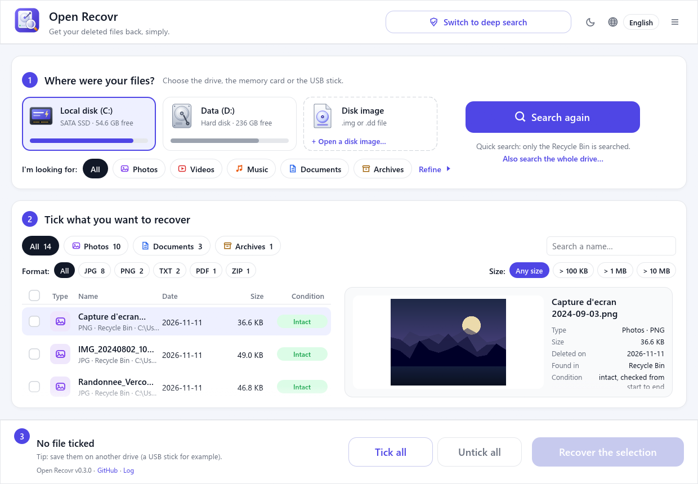
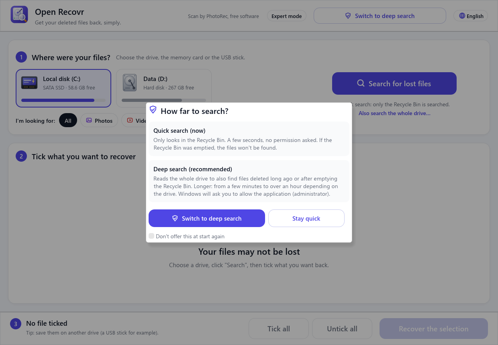
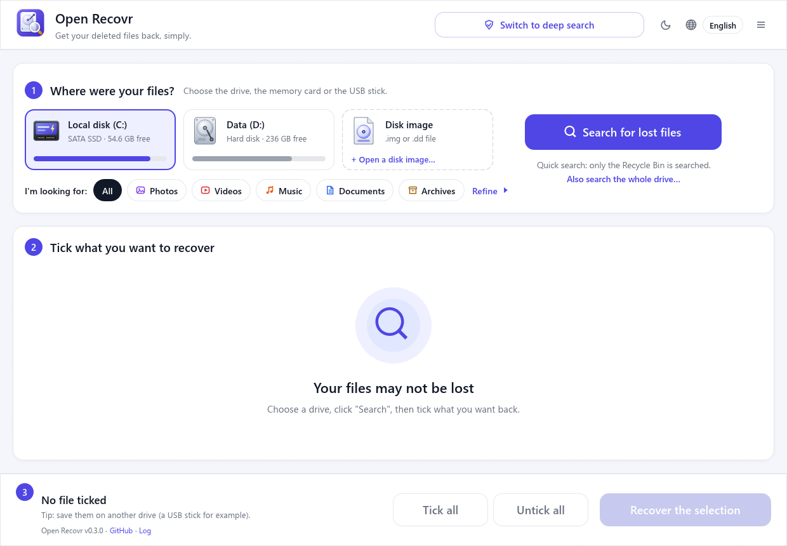
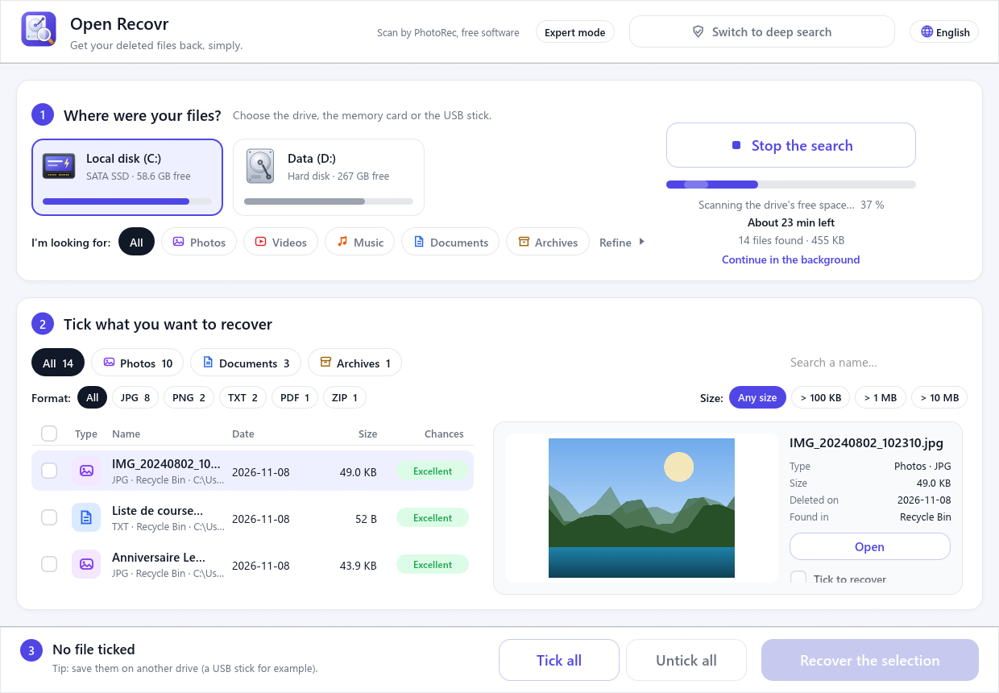
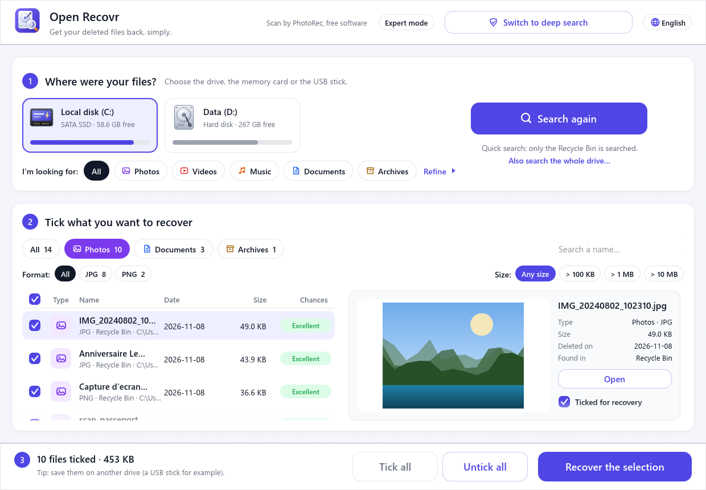
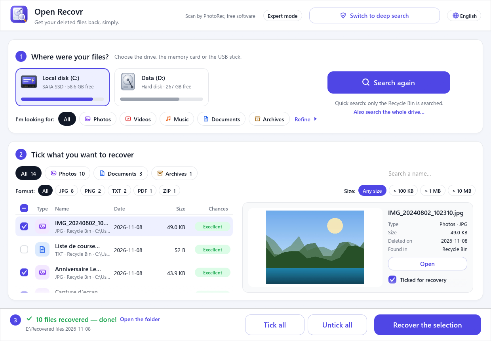
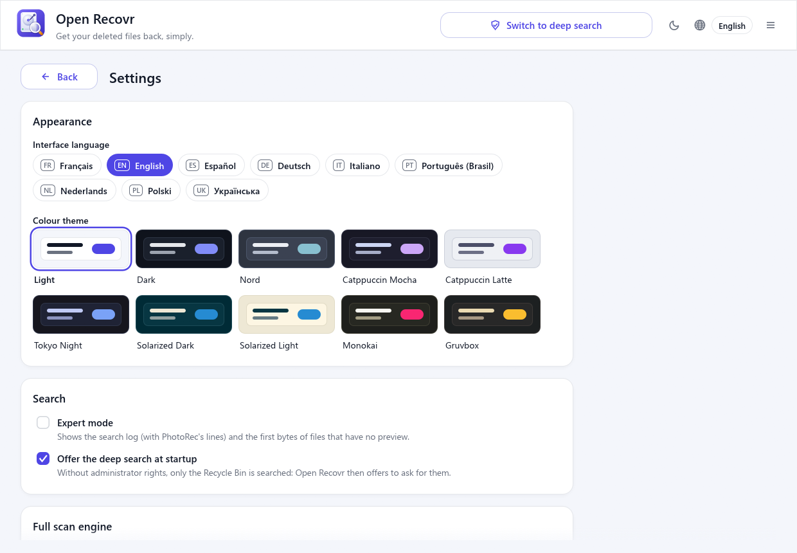
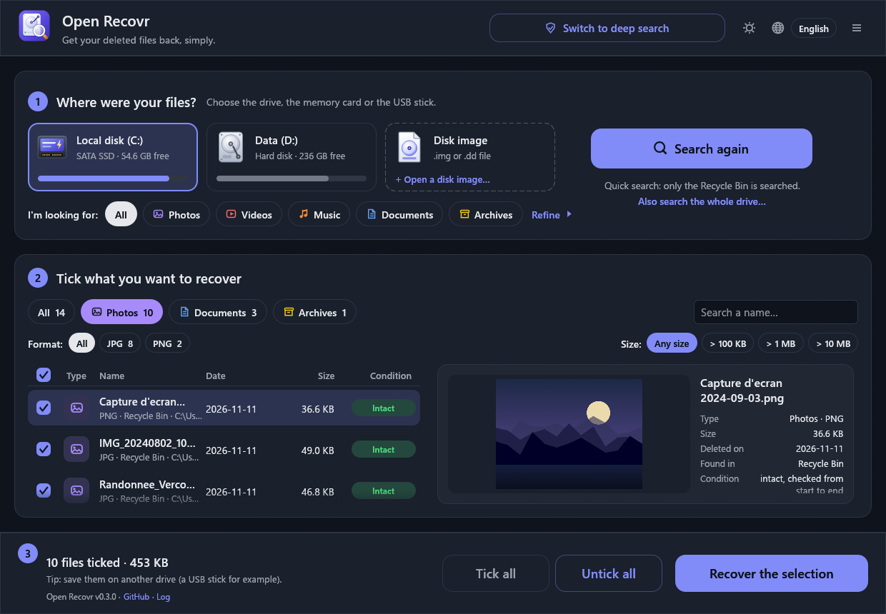
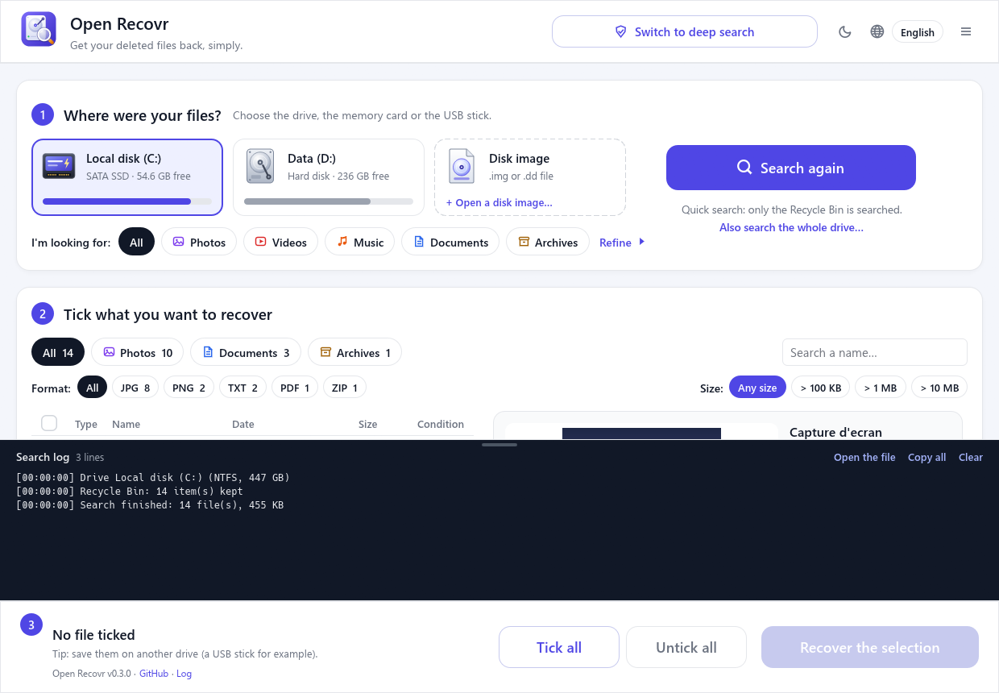
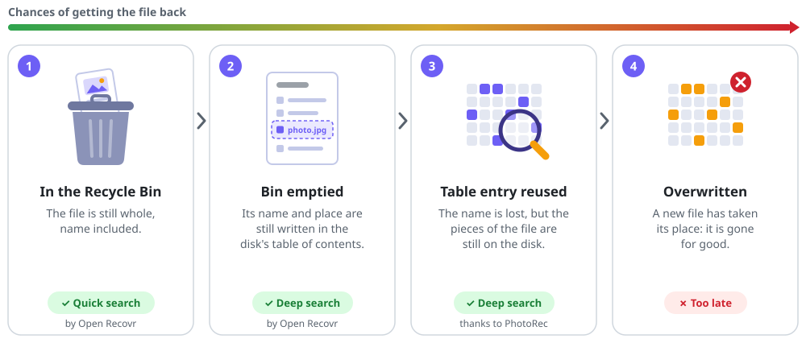

<div align="center">


One screen, no wizard: pick the drive, search, tick what you want back.<br>
Free and open source, with its own recovery engine and [PhotoRec](https://www.cgsecurity.org/wiki/PhotoRec) as an option.

**English** · [Français](README.fr.md) · [Español](README.es.md) · [Deutsch](README.de.md) · [Italiano](README.it.md) · [Português (Brasil)](README.pt.md) · [Nederlands](README.nl.md) · [Polski](README.pl.md) · [Українська](README.uk.md)

[](https://github.com/jlerouge/open-recovr/actions/workflows/ci.yml)
[](https://github.com/jlerouge/open-recovr/releases/latest)
[](https://github.com/jlerouge/open-recovr/releases)
[](LICENSE)
[](https://www.rust-lang.org)
[](#platform-support)
[](CONTRIBUTING.md)
[](https://stand-with-ukraine.pp.ua)



</div>

## Why Open Recovr?

Losing a holiday folder or a thesis is stressful enough. Most recovery tools either cost a lot or bury you in jargon. Free ones like PhotoRec are excellent but run in a text terminal.

Open Recovr puts it all on one friendly screen. A fast search brings files back **with their original names and folders**. For the rest, its own engine reads the whole drive and **puts fragmented pictures, archives and Office files back together**. PhotoRec, the proven free engine, stays available as the classic engine. How the two compare is measured in the [benchmarks](docs/benchmarks.md).

## How it works

| 1. Pick quick or deep | 2. Pick the drive | 3. Search |
|:---:|:---:|:---:|
| [](docs/screenshots/en-1-start.png) | [](docs/screenshots/en-2-home.png) | [](docs/screenshots/en-3-scanning.png) |
| A few seconds in the Recycle Bin, or the whole drive. | Hard disk, SSD, memory card, USB stick, CD… | Files appear as they are found, with the time left. |

| 4. Browse and preview | 5. Tick what you want | 6. Recover |
|:---:|:---:|:---:|
| [](docs/screenshots/en-4-results.png) | [](docs/screenshots/en-5-selected.png) | [](docs/screenshots/en-6-recovered.png) |
| Filter by type, format, size or name. | Each file shows its chances of recovery. | Copied to another drive of your choice. |

| Settings | Dark theme | Expert mode |
|:---:|:---:|:---:|
| [](docs/screenshots/en-8-settings.png) | [](docs/screenshots/en-9-dark.png) | [](docs/screenshots/en-7-expert.png) |
| Language, colour theme, updates, report. | Light, dark and 8 other themes. | The search log, for the curious. |

The full walkthrough is in the **[user guide](docs/user-guide.md)**.

## Where do deleted files go?

Deleting a file does not erase it. The system only forgets where the file is and marks its space as free. The content stays on the disk until something new is written over it. Each kind of search reaches one step further down:

<picture>
  <source media="(prefers-color-scheme: dark)" srcset="docs/illustrations/deleted-file-en-dark.svg">
  
</picture>

At step 3, only the bytes are left. **File carving** scans the whole disk for the signatures that mark the start of each file type and works out where each file ends. When a file was stored in several pieces, the next piece is looked for in the free space. Open Recovr's modern engine does this itself ([how it works](docs/carving.md)). The classic engine hands the job to **[PhotoRec](https://www.cgsecurity.org/wiki/PhotoRec)**, which recognises far more file types. PhotoRec laid solid foundations for this kind of software in open source: many thanks to Christophe Grenier, who has written and maintained it for over twenty years.

The sooner you search, the more there is to find. On an SSD, freed space is often erased in the background soon after (TRIM): steps 1 and 2 still work for recent deletions, but the full scan may find little.

> [!WARNING]
> **Never save recovered files on the drive they came from.** You could overwrite the files that are still waiting to be recovered. A USB stick or another disk is perfect. Open Recovr warns you if you try.

> [!CAUTION]
> **A failing drive (clicking, very slow, read errors) can get worse with every read.** Stop using it, and first copy it whole onto a healthy disk with a tool like [ddrescue](https://www.gnu.org/software/ddrescue/). Then open that copy with *Open a disk image…* and search it as often as you like, without touching the original.

## Features

- 🗑️ **Quick search.** Searches the Recycle Bin / Trash in seconds, with no special rights.
- 🔎 **Quick scan (NTFS).** Reads the drive's file table (MFT), where a deleted file keeps its name until the entry is reused. Files come back with their **real names and folders**, in minutes, even after the bin was emptied.
- 🧲 **Full scan.** Reads the whole drive and finds files by their content, even on formatted drives and on FAT/exFAT cards. The **modern engine**, Open Recovr's own, recognises about forty formats (photos, camera raw, videos, music, Office, PDF, archives, fonts) and **puts fragmented files back together**. The **classic engine**, PhotoRec, recognises **hundreds of file types**; pick it in Settings.
- 💿 **Damaged media.** Unreadable areas (scratched CD/DVD, worn SD card) are skipped instead of freezing the search.
- 🖼️ **Preview before recovering.** Photos, videos, sounds, PDFs, text and Word documents.
- 🏷️ **Names and dates that mean something.** Files that only had a number get one from what they say about themselves: `photo_2024-07-14_18-22-05.jpg` from the EXIF date, the title of a Word or PDF document, the artist and song of an MP3.
- ✅ **Checked before you recover.** Each file found is read from end to end: **Intact**, **Damaged** (with the reason: cut short, mixed with another file, missing index…) or **Empty**.
- 👯 **Duplicates hidden.** The same file found several times is shown once.
- 📀 **Disk images.** Opens an `.img` / `.dd` copy of a failing drive (made with ddrescue, for example), so the original is left alone. No administrator rights needed.
- 🗂️ **Sort and filter** by type (photos, videos, music, documents, archives), format, size and name.
- 💾 **Every kind of drive.** Hard disks, SATA and NVMe SSDs, SD / microSD / CompactFlash cards, USB sticks, external disks, CD/DVD.
- 🕒 **Runs in the background.** The window can hide next to the clock during a long search.
- 🛠️ **Expert mode.** The full search log (and PhotoRec's output with the classic engine), for the curious and for bug reports.
- 🎨 **Colour themes.** Light and dark in one click, plus Nord, Catppuccin, Tokyo Night, Solarized, Monokai and Gruvbox.
- 🔄 **Safe updates.** When a new version is out, one click downloads it, checks its signature and installs it.
- 🩺 **Help report.** *Prepare a report…* saves a zip (system, drives, last search log) to send to someone who helps you, with personal names masked. Open Recovr never sends it itself.
- 🌍 **9 languages:** English, French, Spanish, German, Italian, Brazilian Portuguese, Dutch, Polish, Ukrainian.
- 🔒 **Read-only.** Nothing is ever written to the drive being searched. No account, no telemetry, no internet needed: the only connection is an update check (just the latest version number, asked of GitHub), which can be turned off in Settings.

A phone plugged in over USB cannot be searched. It only shows the files it still has, and its memory is encrypted. Open Recovr explains where to look instead: the Gallery or Photos app's bin, Google Photos, iCloud, or the microSD card.

## Download

Get the latest version from **[Releases](https://github.com/jlerouge/open-recovr/releases/latest)**:

| System | File | How to start it |
|---|---|---|
| **Windows 10 / 11** (64-bit) | `open-recovr-…-windows-x64-setup.exe` or `…-windows-x64.zip` | Run the installer (no administrator rights asked), or unzip and open `open-recovr.exe`. Both update themselves in one click. PhotoRec is optional: Settings can fetch it for the classic engine. |
| Linux (64-bit) | `open-recovr-…-linux-x64.tar.gz` | Extract, then run `./open-recovr`. For the classic engine (optional): `sudo apt install testdisk`. |
| macOS (Apple Silicon / Intel) | `open-recovr-…-macos-arm64.tar.gz` / `…-macos-x64.tar.gz` | Extract, then right-click → *Open* (the app is not signed). For the classic engine (optional): `brew install testdisk`. |

Reading the drive itself (quick scan and full scan) needs administrator rights. Open Recovr asks for them only when you switch to the deep search; the Recycle Bin search works without them.

## Platform support

| | Windows | Linux | macOS |
|---|:---:|:---:|:---:|
| Builds in CI | ✅ | ✅ | ✅ |
| Tested on real hardware | ✅ | ⚠️ not yet | ⚠️ not yet |
| Recycle Bin / Trash | ✅ | ✅ freedesktop Trash | ✅ `.Trash` |
| NTFS file table (quick scan) | ✅ | ✅ NTFS volumes | ✅ NTFS volumes |
| Full scan, modern engine | ✅ | ✅ | ✅ |
| Full scan, classic engine (PhotoRec) | ✅ fetched from Settings | ✅ `apt install testdisk` | ✅ `brew install testdisk` |
| Video / PDF thumbnails, sound preview | ✅ | ❌ | ❌ |
| Icon next to the clock | ✅ | ❌ | ❌ |

**Windows is the main, tested platform.** The Linux and macOS versions compile and their system code is written, but nobody has tested them on real hardware yet. Reports and fixes are very welcome. See [CONTRIBUTING.md](CONTRIBUTING.md).

## Build from source

You need [Rust](https://rustup.rs) 1.95 or newer.

```sh
git clone https://github.com/jlerouge/open-recovr
cd open-recovr
cargo build --release
```

The program is in `target/release/`. For the classic engine on Windows, Settings can fetch PhotoRec; developers can also fetch it once with:

```powershell
powershell -ExecutionPolicy Bypass -File scripts\fetch-photorec.ps1
```

On Linux, also install `libxkbcommon-dev`, `libwayland-dev` and the `libxcb-*-dev` packages listed in [CONTRIBUTING.md](CONTRIBUTING.md).

<details>
<summary><b>Command-line options</b> (for testing and screenshots)</summary>

| Option | Effect |
|---|---|
| `--lang en` | interface language: `en`, `fr`, `es`, `de`, `it`, `pt`, `nl`, `pl`, `uk` |
| `--theme sombre` | colour theme for this run: `clair`, `sombre`, `nord`, `tokyo-night`… |
| `--image disk.img` | search a disk image file instead of a drive |
| `--disk D` | drive to select: a letter (`D`) or a mount point (`/media/usb`) |
| `--search` | start the search right away |
| `--expert` | show the search log for this run |
| `--show file.jpg` | list this file as found, to try its preview |
| `--screenshot out.png` | draw the window off-screen, save it as an image, then quit |
| `--scene name` | with `--screenshot`, the moment to draw: `home`, `scanning`, `selected`, `recovered`, `settings`, `engine`, `engine-none` |
| `--bench [folder]` | measure each search method on a disk image built for the purpose |

</details>

## Documentation

- 📖 [User guide](docs/user-guide.md): every step, with tips and an FAQ
- 🏗️ [Architecture](docs/architecture.md): how the code is organised and how each search works
- 🔬 [Carving](docs/carving.md): how the modern engine finds files and puts them back together
- 📊 [Benchmarks](docs/benchmarks.md): the modern engine and PhotoRec on the same disks
- 🤝 [Contributing](CONTRIBUTING.md): building, testing, translating (AI-assisted contributions welcome)
- 📝 [Changelog](CHANGELOG.md)

## Licence and credits

Open Recovr is free software under the [MIT licence](LICENSE).

Open Recovr's modern engine, used by default for the full scan, is written from scratch from the file format specifications and shares no code with PhotoRec. Its methods are described in [docs/carving.md](docs/carving.md).

The classic engine calls **[PhotoRec](https://www.cgsecurity.org/wiki/PhotoRec)** © Christophe Grenier, released under the GNU GPL v2 or later, as a **separate, unmodified program**. PhotoRec is not included with Open Recovr: on Windows, when you ask for it in Settings, Open Recovr downloads the official PhotoRec 7.2 archive from [cgsecurity.org](https://www.cgsecurity.org/wiki/TestDisk_Download) and checks each file against a known SHA-256; on Linux and macOS it comes from your system's `testdisk` package. PhotoRec laid the groundwork for open-source file carving, and this project owes it a great deal. Thank you, Christophe, for over twenty years of work on TestDisk and PhotoRec.

Open Recovr is an independent project, not affiliated with any commercial recovery software.

## Star history

<a href="https://star-history.com/#jlerouge/open-recovr&Date">
  <picture>
    <source media="(prefers-color-scheme: dark)" srcset="https://api.star-history.com/svg?repos=jlerouge/open-recovr&type=Date&theme=dark">
    
  </picture>
</a>
