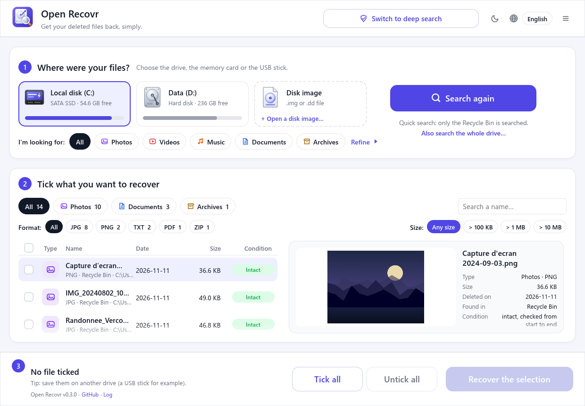
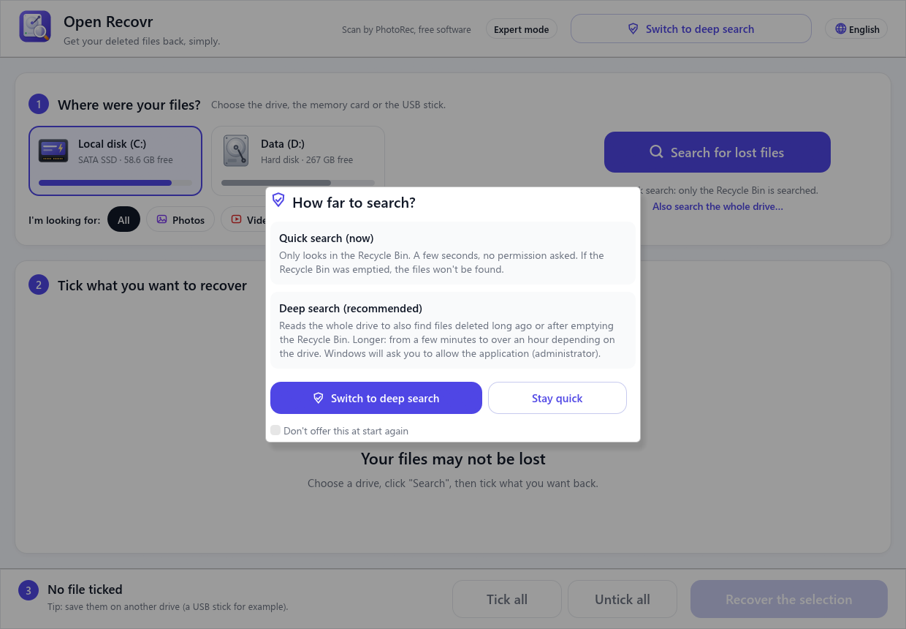
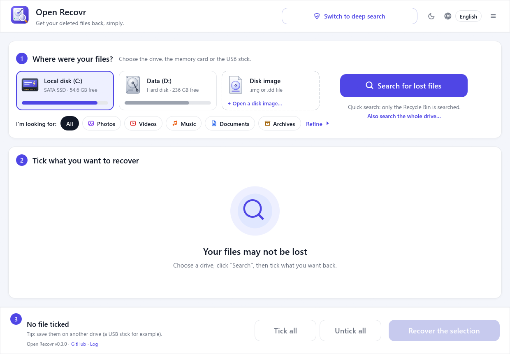
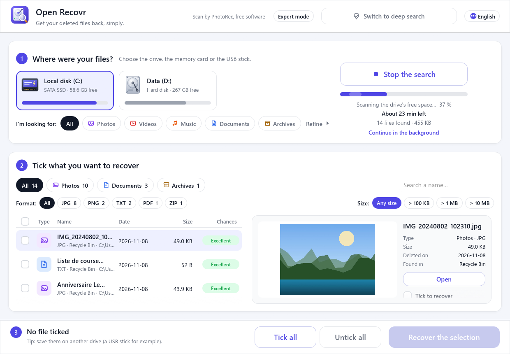
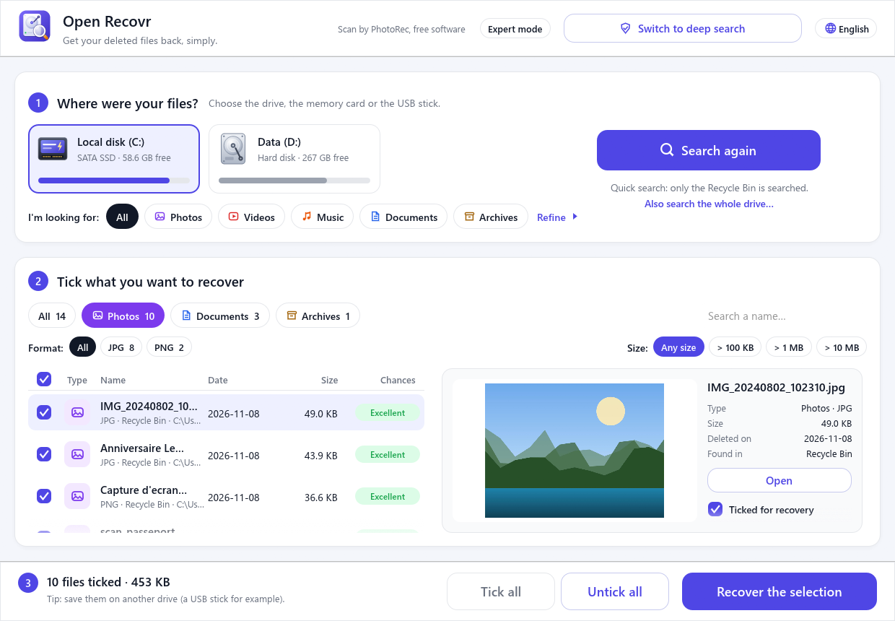
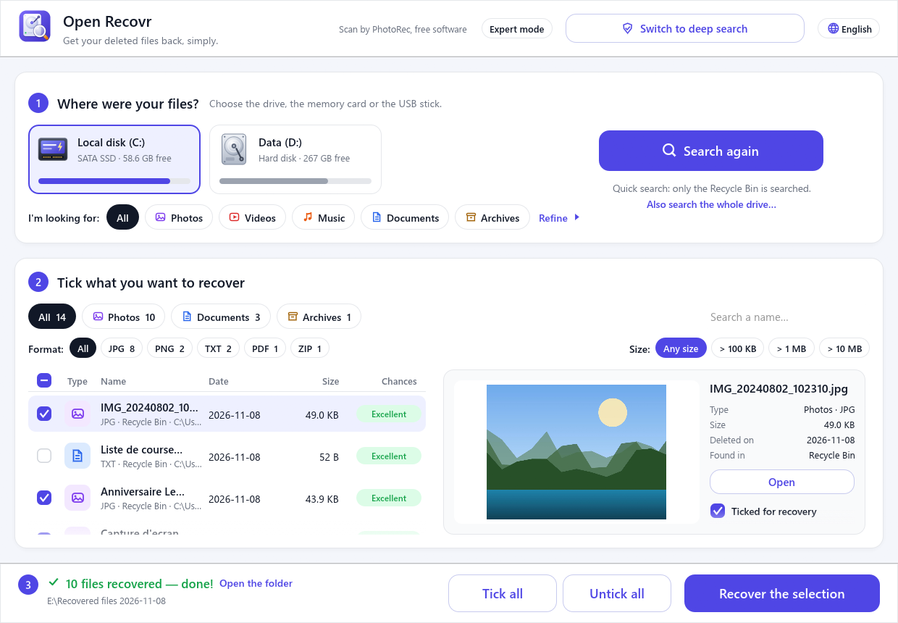
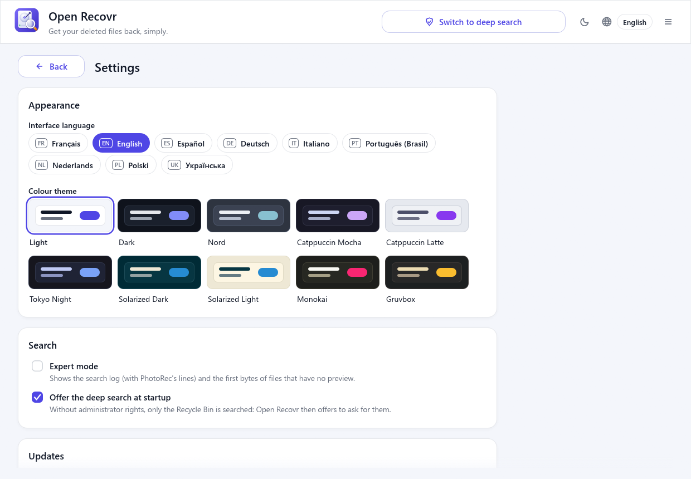
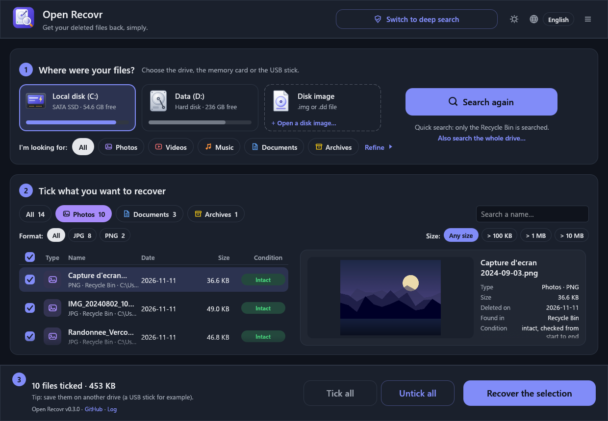
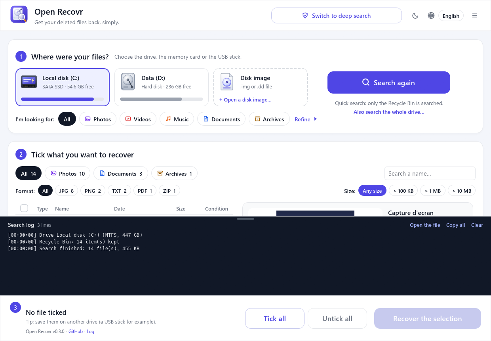

<div align="center">


# Open Recovr

**Haal uw verwijderde bestanden terug, eenvoudig.**

Eén scherm, geen wizard: kies de schijf, zoek en vink aan wat u terug wilt.<br>
Vrij en gratis, met [PhotoRec](https://www.cgsecurity.org/wiki/PhotoRec) als motor.

[English](README.md) · [Français](README.fr.md) · [Español](README.es.md) · [Deutsch](README.de.md) · [Italiano](README.it.md) · [Português (Brasil)](README.pt.md) · **Nederlands** · [Polski](README.pl.md) · [Українська](README.uk.md)

[](https://github.com/jlerouge/open-recovr/actions/workflows/ci.yml)
[](https://github.com/jlerouge/open-recovr/releases/latest)
[](https://github.com/jlerouge/open-recovr/releases)
[](LICENSE)
[](https://www.rust-lang.org)
[](#ondersteunde-systemen)
[](https://stand-with-ukraine.pp.ua)



</div>

> [!NOTE]
> Deze pagina is machinaal vertaald en de schermafbeeldingen zijn in het Engels. Verbeteringen van een moedertaalspreker zijn welkom: zie [CONTRIBUTING.md](CONTRIBUTING.md).

## Waarom Open Recovr?

Een vakantiemap of een scriptie kwijtraken is al stressvol genoeg. Herstelprogramma's zijn vaak duur of zitten vol vakjargon. Gratis programma's zoals PhotoRec zijn uitstekend, maar werken in een tekstterminal.

Open Recovr zet een vriendelijke interface van één scherm bovenop PhotoRec, een beproefde vrije motor. Daarnaast voegt het een snelle analyse toe die bestanden terugbrengt **met hun oorspronkelijke naam en map**.

## Hoe het werkt

| 1. Snel of diep | 2. Kies de schijf | 3. Zoeken |
|:---:|:---:|:---:|
| [](docs/screenshots/en-1-start.png) | [](docs/screenshots/en-2-home.png) | [](docs/screenshots/en-3-scanning.png) |
| Een paar seconden in de Prullenbak, of de hele schijf. | Harde schijf, SSD, geheugenkaart, USB-stick, cd… | Bestanden verschijnen zodra ze gevonden worden, met de resterende tijd. |

| 4. Bekijken | 5. Aanvinken | 6. Herstellen |
|:---:|:---:|:---:|
| [](docs/screenshots/en-4-results.png) | [](docs/screenshots/en-5-selected.png) | [](docs/screenshots/en-6-recovered.png) |
| Filters op type, formaat, grootte of naam. | Elk bestand toont of het intact is. | Gekopieerd naar een schijf naar keuze. |

| Instellingen | Donker thema | Expertmodus |
|:---:|:---:|:---:|
| [](docs/screenshots/en-8-settings.png) | [](docs/screenshots/en-9-dark.png) | [](docs/screenshots/en-7-expert.png) |
| Taal, kleurthema, updates, rapport. | Licht, donker en 8 andere thema's. | Het logboek van de zoekactie, voor nieuwsgierigen. |

De volledige stapsgewijze uitleg staat in de **[gebruikershandleiding](docs/user-guide.nl.md)**.

> [!WARNING]
> **Sla herstelde bestanden nooit op de schijf op waar ze vandaan komen.** U kunt de bestanden overschrijven die nog op herstel wachten. Een USB-stick of een andere schijf is perfect. Open Recovr waarschuwt als u het probeert.

## Functies

- 🗑️ **Direct zoeken** in de Prullenbak, in seconden en zonder bijzondere rechten.
- 🔎 **Snelle analyse (NTFS).** Leest de bestandstabel van de schijf (MFT), waar een verwijderd bestand zijn naam houdt. Bestanden komen terug **met hun naam en map**, in minuten, zelfs nadat de Prullenbak is geleegd.
- 🧲 **Volledige analyse.** PhotoRec leest de hele schijf en herkent **honderden bestandstypen**, zelfs na formatteren of op FAT/exFAT-kaarten. Zonder PhotoRec neemt een ingebouwde engine de gangbaarste formaten voor zijn rekening.
- 💿 **Beschadigde media.** Onleesbare gebieden (bekraste cd/dvd, versleten kaarten) worden overgeslagen in plaats van het zoeken te laten vastlopen.
- 🖼️ **Voorbeeld vóór het herstellen.** Foto's, video's, geluiden, pdf's, teksten en Word-documenten.
- 🏷️ **Namen en datums die iets zeggen.** Een bestand met alleen een nummer krijgt een naam op basis van de inhoud: `photo_2024-07-14_18-22-05.jpg` uit de EXIF-datum, de titel van een Word- of pdf-document, artiest en nummer van een MP3.
- ✅ **Gecontroleerd vóór het herstellen.** Elk gevonden bestand wordt van begin tot eind gelezen: **Intact**, **Beschadigd** (met de reden: afgekapt, vermengd met een ander bestand, index ontbreekt…) of **Leeg**.
- 👯 **Duplicaten verborgen.** Hetzelfde bestand dat meerdere keren is gevonden, wordt één keer getoond.
- 📀 **Schijfkopieën.** Opent een `.img`- / `.dd`-kopie van een falende schijf (bijvoorbeeld gemaakt met ddrescue), zodat het origineel onaangeroerd blijft. Zonder beheerdersrechten.
- 🗂️ **Sorteren en filteren** op type (foto's, video's, muziek, documenten, archieven), formaat, grootte en naam.
- 💾 **Elk soort schijf.** Harde schijven, SATA- en NVMe-SSD's, SD-, microSD- en CompactFlash-kaarten, USB-sticks, externe schijven, cd/dvd.
- 🕒 **Op de achtergrond.** Het venster kan zich tijdens een lange zoekactie naast de klok verbergen.
- 🛠️ **Expertmodus.** Het volledige logboek van de zoekactie en de uitvoer van PhotoRec.
- 🎨 **Kleurthema's.** Licht of donker met één klik, en ook Nord, Catppuccin, Tokyo Night, Solarized, Monokai en Gruvbox.
- 🔄 **Veilige updates.** Als er een nieuwe versie is, downloadt één klik hem, controleert de handtekening en installeert hem.
- 🩺 **Hulprapport.** *Rapport maken…* slaat een zip op (systeem, schijven, logboek van de laatste zoekactie) om te sturen naar wie u helpt, met persoonlijke namen onherkenbaar gemaakt. Open Recovr verstuurt het nooit zelf.
- 🌍 **9 talen:** Nederlands, Engels, Frans, Spaans, Duits, Italiaans, Braziliaans Portugees, Pools en Oekraïens.
- 🔒 **Alleen lezen.** Er wordt nooit iets naar de doorzochte schijf geschreven. Geen account, geen telemetrie, geen internet nodig: de enige verbinding is het zoeken naar updates (het nummer van de nieuwste versie, gevraagd aan GitHub), wat in Instellingen kan worden uitgezet.

Een telefoon die via USB is aangesloten, kan niet worden doorzocht: hij toont alleen de bestanden die hij nog heeft, en zijn geheugen is versleuteld. Open Recovr legt uit waar u in plaats daarvan kunt kijken: de prullenbak van de app Galerij of Foto's, Google Foto's, iCloud of de microSD-kaart.

## Downloaden

Download de nieuwste versie via **[Releases](https://github.com/jlerouge/open-recovr/releases/latest)**:

| Systeem | Bestand | Zo start u het |
|---|---|---|
| **Windows 10 / 11** (64-bit) | `open-recovr-…-windows-x64-setup.exe` of `…-windows-x64.zip` | Start het installatieprogramma (zonder beheerdersrechten), of pak uit en open `open-recovr.exe`. PhotoRec zit erbij. Beide werken zichzelf met één klik bij. |
| Linux (64-bit) | `open-recovr-…-linux-x64.tar.gz` | Pak uit en start `./open-recovr`. Voor de volledige analyse: `sudo apt install testdisk`. |
| macOS (Apple Silicon / Intel) | `open-recovr-…-macos-arm64.tar.gz` / `…-macos-x64.tar.gz` | Pak uit, dan rechtsklik → *Openen* (de app is niet ondertekend). Daarna `brew install testdisk`. |

De schijf zelf lezen (snelle en volledige analyse) vraagt beheerdersrechten. Open Recovr vraagt daar pas om als u overschakelt naar diep zoeken; de Prullenbak wordt zonder doorzocht.

## Ondersteunde systemen

| | Windows | Linux | macOS |
|---|:---:|:---:|:---:|
| Gebouwd in CI | ✅ | ✅ | ✅ |
| Getest op een echte computer | ✅ | ⚠️ nog niet | ⚠️ nog niet |
| Prullenbak | ✅ | ✅ freedesktop-prullenbak | ✅ `.Trash` |
| NTFS-bestandstabel (snelle analyse) | ✅ | ✅ NTFS-volumes | ✅ NTFS-volumes |
| Volledige analyse (PhotoRec) | ✅ meegeleverd | ✅ `apt install testdisk` | ✅ `brew install testdisk` |
| Miniaturen van video / pdf, geluid | ✅ | ❌ | ❌ |
| Pictogram naast de klok | ✅ | ❌ | ❌ |

**Windows is het belangrijkste, geteste platform.** De Linux- en macOS-versies compileren, maar niemand heeft ze nog op een echte computer getest. Meldingen en verbeteringen zijn welkom: zie [CONTRIBUTING.md](CONTRIBUTING.md).

## Zelf bouwen

U hebt [Rust](https://rustup.rs) 1.95 of nieuwer nodig.

```sh
git clone https://github.com/jlerouge/open-recovr
cd open-recovr
cargo build --release
```

Haal op Windows PhotoRec één keer op met `powershell -ExecutionPolicy Bypass -File scripts\fetch-photorec.ps1`. De opdrachtregelopties staan in de [Engelse README](README.md#build-from-source).

## Licentie en dankwoord

Open Recovr is vrije software onder de [MIT-licentie](LICENSE).

De volledige analyse wordt gedaan door **[PhotoRec](https://www.cgsecurity.org/wiki/PhotoRec)** © Christophe Grenier, onder de GNU GPL v2 of later. Open Recovr voert het uit als een **afzonderlijk, ongewijzigd programma**. De Windows-versie bevat PhotoRec 7.2 met zijn licentie (`vendor/testdisk-7.2/COPYING.txt`). De broncode van PhotoRec is beschikbaar op [cgsecurity.org](https://www.cgsecurity.org/wiki/TestDisk_Download).

Open Recovr is een onafhankelijk project, zonder banden met commerciële herstelsoftware.
