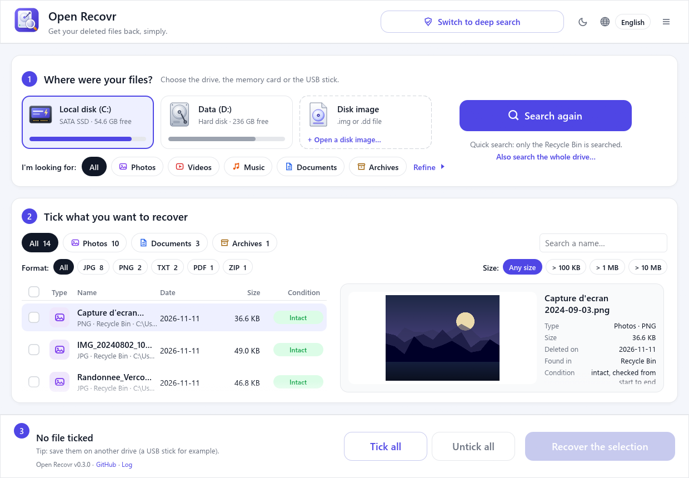
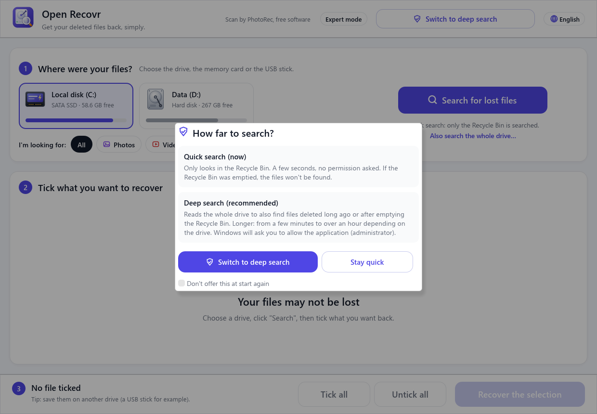
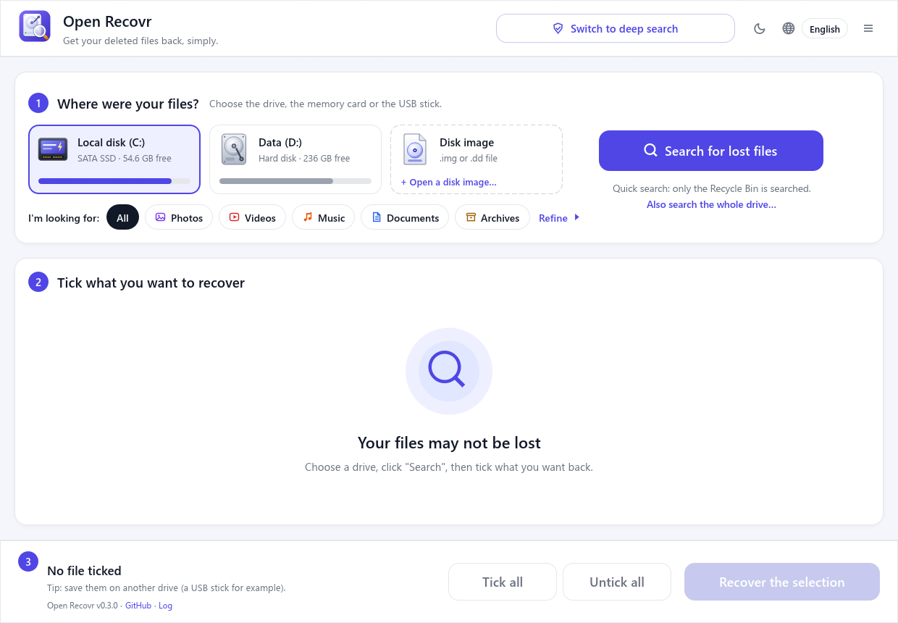
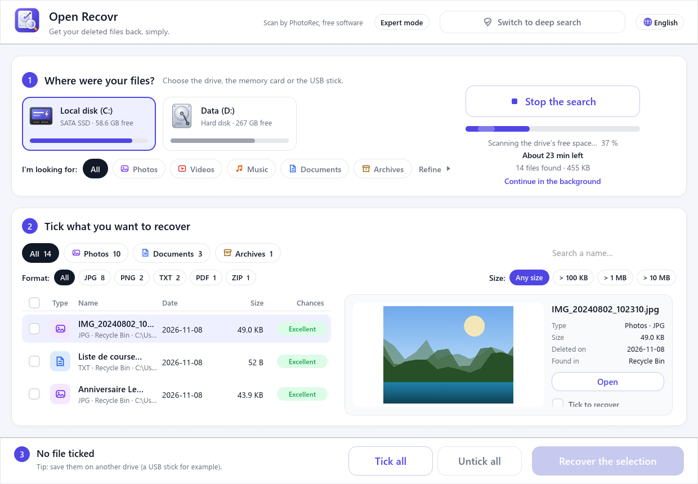
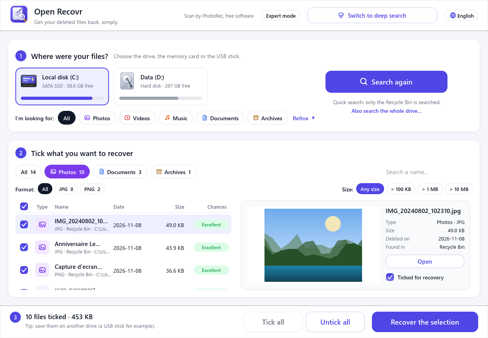
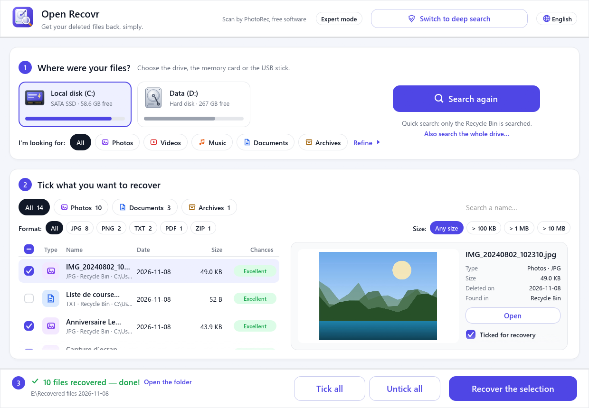
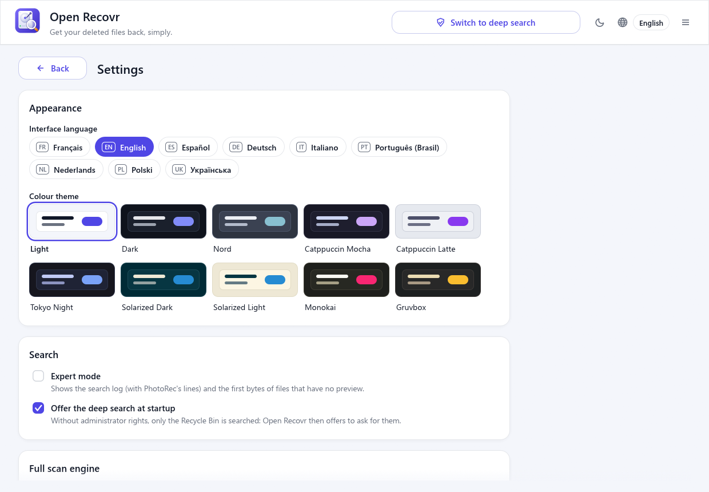
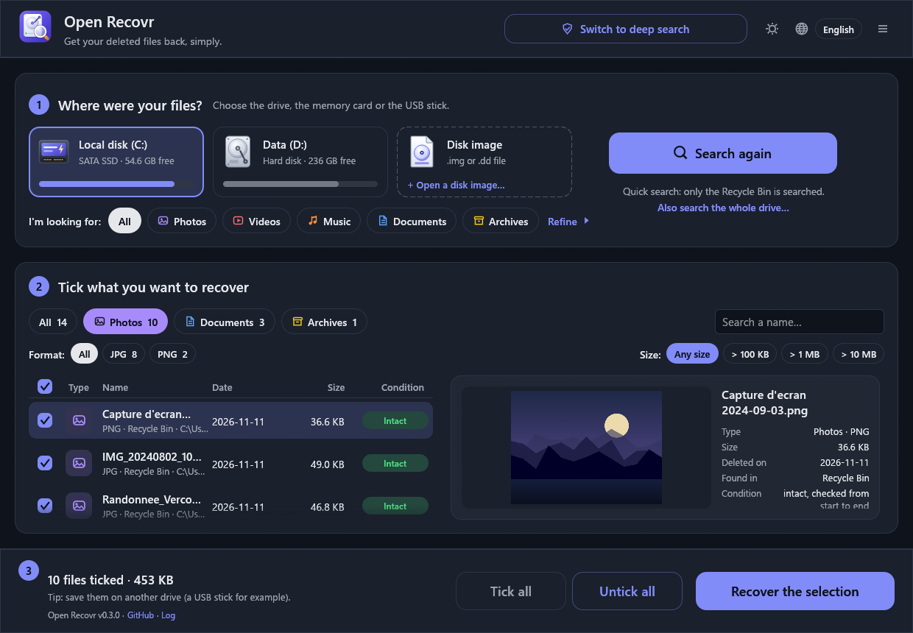
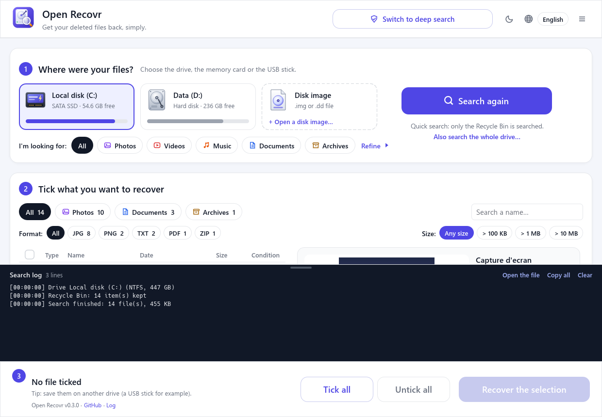
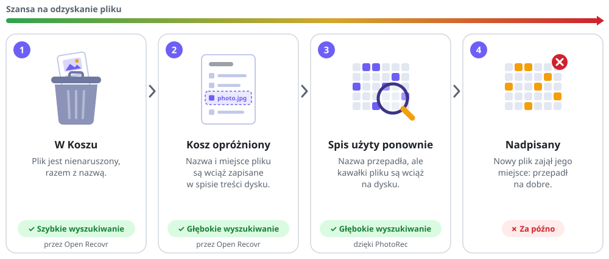

<div align="center">


**Odzyskaj usunięte pliki, po prostu.**

Jeden ekran, bez kreatora: wybierz dysk, szukaj i zaznacz, co chcesz odzyskać.<br>
Wolne i darmowe oprogramowanie z własnym silnikiem odzyskiwania i opcjonalnym [PhotoRec](https://www.cgsecurity.org/wiki/PhotoRec).

[English](README.md) · [Français](README.fr.md) · [Español](README.es.md) · [Deutsch](README.de.md) · [Italiano](README.it.md) · [Português (Brasil)](README.pt.md) · [Nederlands](README.nl.md) · **Polski** · [Українська](README.uk.md)

[](https://github.com/jlerouge/open-recovr/actions/workflows/ci.yml)
[](https://github.com/jlerouge/open-recovr/releases/latest)
[](https://github.com/jlerouge/open-recovr/releases)
[](LICENSE)
[](https://www.rust-lang.org)
[](#obsługiwane-systemy)
[](https://stand-with-ukraine.pp.ua)



</div>

> [!NOTE]
> Ta strona jest tłumaczeniem maszynowym, a zrzuty ekranu są po angielsku. Poprawki od rodzimego użytkownika języka są mile widziane: zobacz [CONTRIBUTING.md](CONTRIBUTING.md).

## Dlaczego Open Recovr?

Utrata folderu ze zdjęciami z wakacji albo pracy dyplomowej to wystarczający stres. Programy do odzyskiwania są często drogie albo pełne żargonu. Darmowe, takie jak PhotoRec, są świetne, ale działają w terminalu tekstowym.

Open Recovr zbiera wszystko na jednym prostym ekranie. Szybkie skanowanie przywraca pliki **z ich oryginalną nazwą i folderem**. Do reszty własny silnik czyta cały dysk i **składa z powrotem pofragmentowane zdjęcia, archiwa i dokumenty Office**. PhotoRec, sprawdzony wolny silnik, pozostaje dostępny jako silnik klasyczny. Porównanie obu zmierzono w [testach porównawczych](docs/benchmarks.md) (po angielsku).

## Jak to działa

| 1. Szybko czy głęboko | 2. Wybierz dysk | 3. Szukaj |
|:---:|:---:|:---:|
| [](docs/screenshots/en-1-start.png) | [](docs/screenshots/en-2-home.png) | [](docs/screenshots/en-3-scanning.png) |
| Kilka sekund w Koszu albo cały dysk. | Dysk twardy, SSD, karta pamięci, pendrive, CD… | Pliki pojawiają się na bieżąco, z pozostałym czasem. |

| 4. Przeglądaj i podglądaj | 5. Zaznacz | 6. Odzyskaj |
|:---:|:---:|:---:|
| [](docs/screenshots/en-4-results.png) | [](docs/screenshots/en-5-selected.png) | [](docs/screenshots/en-6-recovered.png) |
| Filtry według typu, formatu, rozmiaru lub nazwy. | Każdy plik pokazuje, czy jest nienaruszony. | Kopiowane na wybrany przez Ciebie dysk. |

| Ustawienia | Ciemny motyw | Tryb eksperta |
|:---:|:---:|:---:|
| [](docs/screenshots/en-8-settings.png) | [](docs/screenshots/en-9-dark.png) | [](docs/screenshots/en-7-expert.png) |
| Język, motyw kolorów, aktualizacje, raport. | Jasny, ciemny i 8 innych motywów. | Dziennik wyszukiwania, dla ciekawskich. |

Pełny opis krok po kroku jest w **[instrukcji obsługi](docs/user-guide.pl.md)**.

## Gdzie trafiają usunięte pliki?

Usunięcie pliku go nie kasuje. System tylko zapomina, gdzie plik leży, i oznacza jego miejsce jako wolne. Zawartość zostaje na dysku, dopóki coś nowego nie zostanie na niej zapisane. Każde wyszukiwanie sięga o stopień głębiej:

<picture>
  <source media="(prefers-color-scheme: dark)" srcset="docs/illustrations/deleted-file-pl-dark.svg">
  
</picture>

Na etapie 3 zostają tylko bajty. **File carving** przeszukuje cały dysk w poszukiwaniu sygnatur, które oznaczają początek każdego typu pliku, i ustala, gdzie każdy plik się kończy. Gdy plik był zapisany w kilku kawałkach, następny kawałek jest szukany w wolnym miejscu. Nowoczesny silnik Open Recovr robi to sam ([jak](docs/carving.md), po angielsku). Silnik klasyczny powierza tę pracę programowi **[PhotoRec](https://www.cgsecurity.org/wiki/PhotoRec)**, który rozpoznaje znacznie więcej typów plików. PhotoRec położył solidne podstawy pod tego rodzaju otwarte oprogramowanie: wielkie podziękowania dla Christophe'a Greniera, który pisze go i rozwija od ponad dwudziestu lat.

Im szybciej zaczniesz szukać, tym więcej znajdziesz. Na dysku SSD zwolnione miejsce jest często kasowane w tle wkrótce potem (TRIM): etapy 1 i 2 nadal działają dla niedawno usuniętych plików, ale pełne skanowanie może znaleźć niewiele.

> [!WARNING]
> **Nigdy nie zapisuj odzyskanych plików na dysku, z którego pochodzą.** Możesz nadpisać pliki, które jeszcze czekają na odzyskanie. Pendrive albo inny dysk będzie idealny. Open Recovr ostrzeże Cię, jeśli spróbujesz.

> [!CAUTION]
> **Psujący się dysk (stuki, duże spowolnienie, błędy odczytu) może się pogarszać przy każdym odczycie.** Przestań go używać i najpierw skopiuj go w całości na sprawny dysk narzędziem takim jak [ddrescue](https://www.gnu.org/software/ddrescue/). Potem otwórz tę kopię przyciskiem *Otwórz obraz dysku…* i przeszukuj ją, ile chcesz, bez dotykania oryginału.

## Funkcje

- 🗑️ **Szybkie wyszukiwanie** w Koszu, w kilka sekund i bez specjalnych uprawnień.
- 🔎 **Szybkie skanowanie (NTFS).** Czyta tablicę plików dysku (MFT), w której usunięty plik zachowuje nazwę. Pliki wracają **z nazwą i folderem**, w kilka minut, nawet po opróżnieniu Kosza.
- 🧲 **Pełne skanowanie.** Cały dysk jest czytany, a pliki są rozpoznawane po zawartości, nawet po formatowaniu i na kartach FAT/exFAT. **Nowoczesny silnik**, własny silnik Open Recovr, rozpoznaje około czterdziestu formatów (zdjęcia, RAW, wideo, muzyka, Office, PDF, archiwa, czcionki) i **składa z powrotem pofragmentowane pliki**. **Silnik klasyczny**, PhotoRec, rozpoznaje **setki typów plików**; wybiera się go w Ustawieniach.
- 💿 **Uszkodzone nośniki.** Nieczytelne obszary (porysowane CD/DVD, zużyte karty) są pomijane, zamiast blokować wyszukiwanie.
- 🖼️ **Podgląd przed odzyskaniem.** Zdjęcia, filmy, dźwięki, PDF-y, teksty i dokumenty Word.
- 🏷️ **Sensowne nazwy i daty.** Plik, który miał tylko numer, dostaje nazwę z zawartości: `photo_2024-07-14_18-22-05.jpg` z daty EXIF, tytuł dokumentu Word lub PDF, wykonawca i tytuł utworu MP3.
- ✅ **Sprawdzone przed odzyskaniem.** Każdy znaleziony plik jest czytany od początku do końca: **Nienaruszony**, **Uszkodzony** (z przyczyną: ucięty, pomieszany z innym plikiem, brak indeksu…) lub **Pusty**.
- 👯 **Ukryte duplikaty.** Ten sam plik znaleziony kilka razy jest pokazywany raz.
- 📀 **Obrazy dysków.** Otwiera kopię `.img` / `.dd` psującego się dysku (zrobioną na przykład za pomocą ddrescue), aby nie dotykać oryginału. Bez uprawnień administratora.
- 🗂️ **Sortowanie i filtry** według typu (zdjęcia, filmy, muzyka, dokumenty, archiwa), formatu, rozmiaru i nazwy.
- 💾 **Każdy rodzaj dysku.** Dyski twarde, SSD SATA i NVMe, karty SD, microSD i CompactFlash, pendrive'y, dyski zewnętrzne, CD/DVD.
- 🕒 **W tle.** Podczas długiego wyszukiwania okno może schować się obok zegara.
- 🛠️ **Tryb eksperta.** Pełny dziennik wyszukiwania (i wyjście PhotoRec przy silniku klasycznym).
- 🎨 **Motywy kolorów.** Jasny lub ciemny jednym kliknięciem, a także Nord, Catppuccin, Tokyo Night, Solarized, Monokai i Gruvbox.
- 🔄 **Bezpieczne aktualizacje.** Gdy wyjdzie nowa wersja, jedno kliknięcie ją pobiera, sprawdza podpis i instaluje.
- 🩺 **Raport pomocy.** *Przygotuj raport…* zapisuje plik zip (system, dyski, dziennik ostatniego wyszukiwania) do wysłania osobie, która Ci pomaga, z zamaskowanymi danymi osobistymi. Open Recovr nigdy nie wysyła go sam.
- 🌍 **9 języków:** polski, angielski, francuski, hiszpański, niemiecki, włoski, portugalski (Brazylia), niderlandzki i ukraiński.
- 🔒 **Tylko odczyt.** Na przeszukiwanym dysku nigdy nic nie jest zapisywane. Bez konta, bez telemetrii, bez potrzeby internetu: jedyne połączenie to sprawdzanie aktualizacji (numer najnowszej wersji, pobierany z GitHuba), które można wyłączyć w Ustawieniach.

Telefonu podłączonego przez USB nie można przeszukać: pokazuje tylko pliki, które jeszcze ma, a jego pamięć jest zaszyfrowana. Open Recovr wyjaśnia, gdzie szukać zamiast tego: w koszu aplikacji Galeria lub Zdjęcia, w Zdjęciach Google, w iCloud albo na karcie microSD.

## Pobieranie

Pobierz najnowszą wersję z **[Releases](https://github.com/jlerouge/open-recovr/releases/latest)**:

| System | Plik | Jak uruchomić |
|---|---|---|
| **Windows 10 / 11** (64-bit) | `open-recovr-…-windows-x64-setup.exe` lub `…-windows-x64.zip` | Uruchom instalator (bez uprawnień administratora) albo rozpakuj i otwórz `open-recovr.exe`. Obie wersje aktualizują się jednym kliknięciem. PhotoRec jest opcjonalny: Ustawienia mogą go pobrać dla silnika klasycznego. |
| Linux (64-bit) | `open-recovr-…-linux-x64.tar.gz` | Rozpakuj i uruchom `./open-recovr`. Dla silnika klasycznego (opcjonalnie): `sudo apt install testdisk`. |
| macOS (Apple Silicon / Intel) | `open-recovr-…-macos-arm64.tar.gz` / `…-macos-x64.tar.gz` | Rozpakuj, potem prawy przycisk → *Otwórz* (aplikacja nie jest podpisana). Dla silnika klasycznego (opcjonalnie): `brew install testdisk`. |

Odczyt samego dysku (szybkie i pełne skanowanie) wymaga uprawnień administratora. Open Recovr prosi o nie dopiero, gdy przechodzisz do głębokiego wyszukiwania; Kosz jest przeszukiwany bez nich.

## Obsługiwane systemy

| | Windows | Linux | macOS |
|---|:---:|:---:|:---:|
| Kompilowany w CI | ✅ | ✅ | ✅ |
| Testowany na prawdziwym komputerze | ✅ | ⚠️ jeszcze nie | ⚠️ jeszcze nie |
| Kosz | ✅ | ✅ kosz freedesktop | ✅ `.Trash` |
| Tablica plików NTFS (szybkie skanowanie) | ✅ | ✅ woluminy NTFS | ✅ woluminy NTFS |
| Pełne skanowanie, nowoczesny silnik | ✅ | ✅ | ✅ |
| Pełne skanowanie, silnik klasyczny (PhotoRec) | ✅ pobierany w Ustawieniach | ✅ `apt install testdisk` | ✅ `brew install testdisk` |
| Miniatury wideo / PDF, dźwięk | ✅ | ❌ | ❌ |
| Ikona obok zegara | ✅ | ❌ | ❌ |

**Windows to główna, przetestowana platforma.** Wersje dla Linuksa i macOS się kompilują, ale nikt jeszcze nie przetestował ich na prawdziwym komputerze. Zgłoszenia i poprawki są mile widziane: zobacz [CONTRIBUTING.md](CONTRIBUTING.md).

## Kompilacja

Potrzebujesz [Rust](https://rustup.rs) 1.95 lub nowszego.

```sh
git clone https://github.com/jlerouge/open-recovr
cd open-recovr
cargo build --release
```

Dla silnika klasycznego w Windows Ustawienia mogą pobrać PhotoRec; programiści mogą też pobrać go raz poleceniem `powershell -ExecutionPolicy Bypass -File scripts\fetch-photorec.ps1`. Opcje wiersza poleceń są opisane w [angielskim README](README.md#build-from-source).

## Licencja i podziękowania

Open Recovr jest wolnym oprogramowaniem na [licencji MIT](LICENSE).

Nowoczesny silnik Open Recovr, domyślnie używany do pełnego skanowania, został napisany od zera na podstawie specyfikacji formatów plików i nie dzieli kodu z PhotoRec. Jego metody opisano w [docs/carving.md](docs/carving.md) (po angielsku).

Silnik klasyczny uruchamia **[PhotoRec](https://www.cgsecurity.org/wiki/PhotoRec)** © Christophe Grenier, na licencji GNU GPL v2 lub nowszej, jako **osobny, niezmieniony program**. PhotoRec nie jest dołączany do Open Recovr: w Windows, gdy poprosisz o to w Ustawieniach, Open Recovr pobiera oficjalne archiwum PhotoRec 7.2 z [cgsecurity.org](https://www.cgsecurity.org/wiki/TestDisk_Download) i sprawdza każdy plik ze znanym SHA-256; w Linuksie i macOS pochodzi z systemowego pakietu `testdisk`. PhotoRec położył podstawy otwartego file carvingu, a ten projekt wiele mu zawdzięcza. Dziękujemy, Christophe, za ponad dwadzieścia lat pracy nad TestDisk i PhotoRec.

Open Recovr to niezależny projekt, niezwiązany z żadnym komercyjnym oprogramowaniem do odzyskiwania danych.
