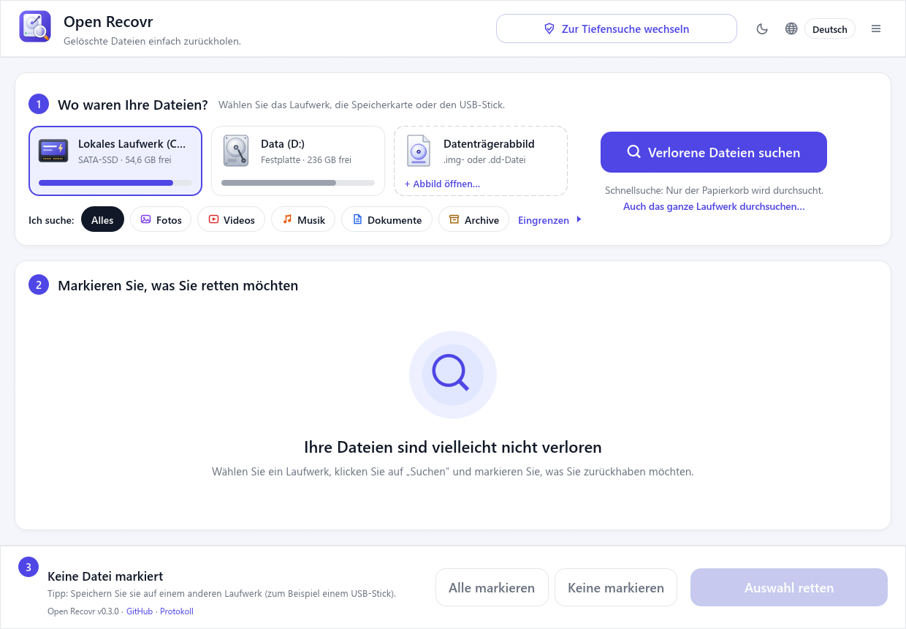
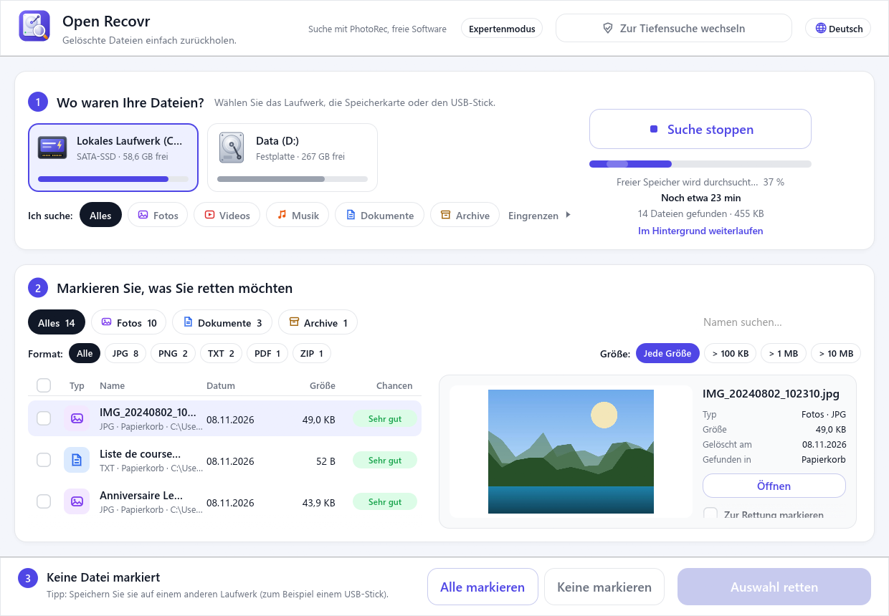
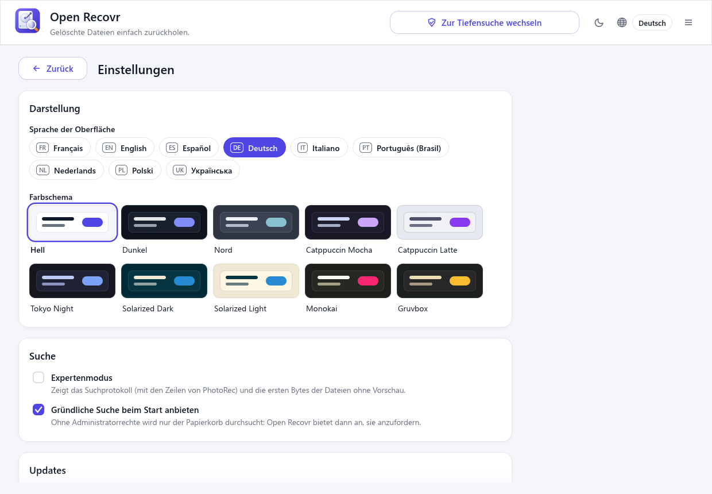
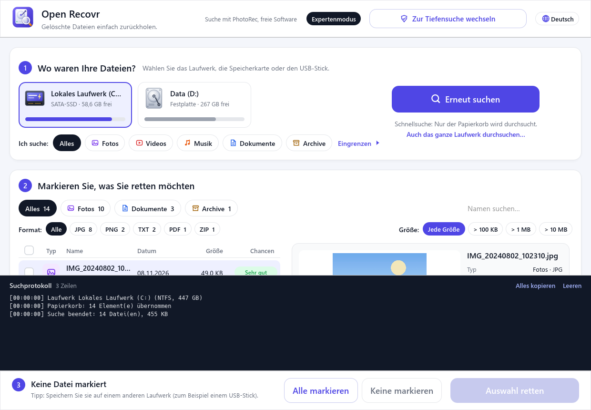

# Benutzerhandbuch

[English](user-guide.md) · [Français](user-guide.fr.md) · [Español](user-guide.es.md) · **Deutsch** · [Italiano](user-guide.it.md) · [Português (Brasil)](user-guide.pt.md) · [Nederlands](user-guide.nl.md) · [Polski](user-guide.pl.md) · [Українська](user-guide.uk.md)

Dieses Handbuch führt einmal vollständig durch eine Wiederherstellung. Die App spricht Deutsch, Englisch, Französisch, Spanisch, Italienisch, brasilianisches Portugiesisch, Niederländisch, Polnisch und Ukrainisch: Die Sprachschaltfläche ist oben rechts.

- [Bevor Sie anfangen](#bevor-sie-anfangen)
- [1. Schnell- oder Tiefensuche](#1-schnell--oder-tiefensuche)
- [2. Laufwerk und Gesuchtes wählen](#2-laufwerk-und-gesuchtes-wählen)
- [3. Die Suche](#3-die-suche)
- [4. Ergebnisse durchsehen](#4-ergebnisse-durchsehen)
- [5. Markieren, was zurück soll](#5-markieren-was-zurück-soll)
- [6. Retten](#6-retten)
- [Datenträgerabbilder](#datenträgerabbilder)
- [Einstellungen, Farbschemata und Updates](#einstellungen-farbschemata-und-updates)
- [Expertenmodus](#expertenmodus)
- [Jemanden um Hilfe bitten](#jemanden-um-hilfe-bitten)
- [Häufige Fragen](#häufige-fragen)

## Bevor Sie anfangen

**Benutzen Sie das Laufwerk so wenig wie möglich.** Eine gelöschte Datei bleibt auf dem Laufwerk, bis etwas Neues darüber geschrieben wird. Jeder Download, jede Installation und jedes Speichern auf diesem Laufwerk verringert Ihre Chancen.

- Lagen die Dateien auf dem Systemlaufwerk (meist `C:`), installieren Sie dort nichts. Starten Sie Open Recovr nach Möglichkeit von einem USB-Stick.
- Lagen sie auf einer Speicherkarte oder einem USB-Stick, nehmen Sie ihn heraus und machen Sie keine neuen Fotos damit.
- **Halten Sie ein anderes Laufwerk bereit**, das die geretteten Dateien aufnimmt: einen USB-Stick, eine externe Festplatte oder eine zweite interne Festplatte.

## 1. Schnell- oder Tiefensuche

Beim Start fragt Open Recovr, wie gründlich gesucht werden soll:

- Die **Schnellsuche** schaut nur im Papierkorb nach. Sie dauert ein paar Sekunden und braucht keine besonderen Rechte. Wenn Sie den Papierkorb geleert haben, findet sie nichts.
- Die **Tiefensuche** liest das Laufwerk selbst. Sie braucht Administratorrechte: Windows bittet Sie, die App zuzulassen (unter Linux und macOS werden Sie nach Ihrem Passwort gefragt).

Später können Sie mit der Schaltfläche **Zur Tiefensuche wechseln** oben umschalten. Setzen Sie den Haken bei *Beim Start nicht mehr vorschlagen*, wenn Sie immer dasselbe wählen.

## 2. Laufwerk und Gesuchtes wählen

**Wo waren Ihre Dateien?** Klicken Sie auf das Laufwerk, die Karte oder den Stick, auf dem die Dateien lagen. Jedes zeigt seine Art (Festplatte, SATA- oder NVMe-SSD, SD-Karte, USB-Stick, CD…), seinen freien Platz und seinen Namen.

**Ich suche:** beschränkt die Suche auf *Fotos*, *Videos*, *Musik*, *Dokumente* oder *Archive*. Weniger Arten machen die Suche schneller und die Liste kürzer. **Eingrenzen** geht weiter: bestimmte Formate (nur JPG, nur DOCX…) und eine Mindestgröße.

In der Tiefensuche bieten NTFS-Laufwerke (die meisten Windows-Festplatten) zwei Analysen:

| Analyse | Was sie liest | Dauer | Namen erhalten? |
|---|---|---|---|
| **Schnell** | Die Dateitabelle des Laufwerks (MFT) | Ein paar Minuten | ✅ Name und Ordner |
| **Vollständig** | Die Dateitabelle, dann das ganze Laufwerk mit PhotoRec | Von Minuten bis über eine Stunde | Teilweise (siehe unten) |

Beginnen Sie mit **Schnell**. Ist Ihre Datei nicht dabei, klicken Sie auf **Nicht gefunden? Vollständige Analyse starten**.

Auf anderen Dateisystemen (Speicherkarten mit FAT32 und exFAT, ext4, APFS…) geht die Tiefensuche direkt zur vollständigen Analyse über.

## 3. Die Suche

Klicken Sie auf **Verlorene Dateien suchen**. Die Dateien erscheinen in der Liste, **sobald sie gefunden werden**: Sie müssen nicht bis zum Ende warten, um sich umzusehen.

Rechts sehen Sie die aktuelle Phase, den Fortschritt, eine Schätzung der Restzeit und wie viele Dateien bisher gefunden wurden.

- **Suche stoppen** behält, was schon gefunden wurde.
- **Im Hintergrund weiterlaufen** legt das Fenster neben der Uhr ab (Windows). Ein Klick auf das Symbol holt es zurück. Eine Benachrichtigung meldet das Ende der Suche.

Unlesbare Bereiche, etwa auf einer zerkratzten CD oder einer abgenutzten Karte, werden übersprungen. Die Suche läuft weiter, statt hängen zu bleiben.

## 4. Ergebnisse durchsehen

- Die **Reiter** oben (*Alles*, *Fotos*, *Dokumente*…) zeigen, wie viele Dateien jeder Art gefunden wurden.
- **Format** und **Größe** filtern weiter. Das Suchfeld filtert nach Namen.
- Ein Klick auf eine Spaltenüberschrift **sortiert** nach Art, Name, Datum oder Größe.
- Ein Klick auf eine Datei zeigt rechts ihre **Vorschau** und ihre Details. Fotos, Videos, Töne, PDFs, Texte und Word-Dokumente lassen sich ansehen. **Öffnen** öffnet sie im üblichen Programm, aus einer temporären Kopie.

Jede gefundene Datei wird von vorne bis hinten gelesen, und die Spalte **Zustand** zeigt das Ergebnis:

| Zustand | Bedeutung |
|---|---|
| **Intakt** | Die Datei wurde von Anfang bis Ende geprüft und ist vollständig. Sie kommt so zurück, wie sie war. |
| **Beschädigt** | Ein Teil fehlt oder ist falsch. Die Details sagen, warum: abgeschnitten, mit einer anderen Datei vermischt, Index fehlt… Sie lässt sich vielleicht noch teilweise öffnen. |
| **Leer** | Der Platz, den sie belegte, enthält nur Nullen. Es gibt nichts mehr zu retten. |

Dieselbe Datei wird oft mehrmals gefunden (zum Beispiel im Papierkorb und auf dem Laufwerk). Die Kopien verbergen sich hinter einem Link *Duplikate ausgeblendet · Anzeigen*.

Von PhotoRec gefundene Dateien haben keinen eigenen Namen. Open Recovr gibt ihnen, wenn möglich, einen aus ihrem Inhalt: `photo_2024-07-14_18-22-05.jpg` aus dem Aufnahmedatum eines Fotos, den Titel eines Word- oder PDF-Dokuments, Künstler und Titel einer MP3.

## 5. Markieren, was zurück soll

Markieren Sie die Dateien einzeln oder nutzen Sie das Kästchen im Spaltenkopf, um alles in der aktuellen Ansicht zu markieren. **Alle markieren** und **Keine markieren** unten wirken auf die ganze Liste. Die untere Leiste zeigt, wie viele Dateien markiert sind und wie groß sie zusammen sind.

## 6. Retten

Klicken Sie auf **Auswahl retten** und wählen Sie einen Ordner **auf einem anderen Laufwerk**. Wählen Sie das durchsuchte Laufwerk, warnt Open Recovr Sie, dass Sie andere rettbare Dateien überschreiben könnten.

Die Dateien werden in einen neuen Ordner *Gerettete Dateien* mit dem Datum kopiert, mit einem Unterordner je Art (Fotos, Dokumente…). Ein in den Papierkorb verschobener Ordner kommt vollständig zurück. Am Ende zeigt **Ordner öffnen** sie Ihnen.

Auf das durchsuchte Laufwerk wird nie etwas geschrieben. Die Dateien werden nur davon gelesen.

## Datenträgerabbilder

Ein sterbendes Laufwerk (klackert, ist sehr langsam, voller Lesefehler) kann während der Suche endgültig aufgeben. Sicherer ist es, es einmal Sektor für Sektor mit einem Werkzeug wie [ddrescue](https://www.gnu.org/software/ddrescue/) zu kopieren und dann die Kopie zu durchsuchen.

Die Karte **Datenträgerabbild** neben den Laufwerken öffnet eine solche Kopie (`.img`, `.dd`, `.raw`…). Die Suche funktioniert dann wie auf einem Laufwerk, ohne Administratorrechte, und das Original bleibt unberührt.

## Einstellungen, Farbschemata und Updates

Das Menü oben rechts (☰) enthält alles, was man zum Retten nicht direkt braucht:

- **Einstellungen**: Sprache, Farbschema, Expertenmodus, ob die Tiefensuche beim Start vorgeschlagen wird, Updates und Informationen über die App.
- **Farbschema**: hell, dunkel, Nord, Catppuccin, Tokyo Night, Solarized, Monokai oder Gruvbox. Die Sonne/Mond-Schaltfläche neben der Sprache wechselt mit einem Klick zwischen hell und dunkel.
- **Nach Updates suchen**, **Bericht erstellen…** und die Projektseite auf GitHub.

Wenn eine neue Version erscheint, zeigt die untere Leiste **→ v…: aktualisieren**. Ein Klick lädt sie herunter, prüft, dass sie mit dem Schlüssel des Projekts signiert ist, installiert sie und startet Open Recovr neu. Läuft gerade eine Suche oder Rettung, wartet das Update, bis sie fertig ist.

## Expertenmodus

Der **Expertenmodus** im Menü oben rechts zeigt unter der Liste das Protokoll der Suche: Laufwerk und Dateisystem, jede Phase und die Zeilen von PhotoRec. **Alles kopieren** kopiert das Protokoll, praktisch für eine Fehlermeldung. Ziehen Sie den oberen Rand des Protokolls, um es zu vergrößern.

Jede Suche wird außerdem in `journal.txt` neben den Einstellungen geschrieben (`%APPDATA%\Open Recovr` unter Windows). Der Link **Protokoll** unten öffnet die Datei.

## Jemanden um Hilfe bitten

Im Menü oben rechts (☰) speichert **Bericht erstellen…** ein Zip, das Sie der Person schicken können, die Ihnen hilft, per E-Mail oder auf anderem Weg. Open Recovr schreibt die Datei nur; es verschickt sie nie. Darin liegen Textdateien: was der Bericht ist, System und Laufwerke (Modell, Größe, Dateisystem), die Einstellungen und das Protokoll der letzten Suche. Bevor etwas geschrieben wird, werden Ihr Kontoname, der Name des Computers, Ihr persönlicher Ordner und E-Mail-Adressen unkenntlich gemacht, ebenso die Dokumenttitel, die PhotoRec in die Namen gefundener Dateien schreibt. Öffnen und lesen Sie das Zip, bevor Sie es weitergeben.

## Häufige Fragen

**Meine Datei ist nicht in der Liste. Was nun?**
Prüfen Sie, dass das richtige Laufwerk gewählt ist und der Artfilter sie nicht verbirgt (*Alles*). Versuchen Sie dann die Tiefensuche und auf NTFS die vollständige Analyse. Wurde das Laufwerk seit dem Löschen viel benutzt, ist die Datei womöglich überschrieben. Dann kann sie keine Software zurückholen.

**Die geretteten Dateien heißen `f1234567.jpg`.**
Diese Dateien hat PhotoRec gefunden, das eine Datei an ihrem Inhalt erkennt und nicht über die Dateitabelle: Ihr ursprünglicher Name ist unbekannt. Wenn die Datei selbst nichts über Datum oder Titel verrät, bleibt die Nummer. Sortieren Sie nach Datum oder Größe und nutzen Sie die Vorschau, um Ihre zu finden.

**Eine Datei ist als Beschädigt markiert. Lohnt sich die Rettung?**
Oft ja. Ein beschädigtes Foto zeigt vielleicht nur die obere Hälfte, ein beschädigtes Video läuft vielleicht bis zur kaputten Stelle. Retten Sie es und probieren Sie es aus: Es kostet nichts, und das Laufwerk wird nie verändert.

**Kann es Dateien von meinem Handy retten?**
Nicht über USB. Ein Handy gibt nur die Dateien frei, die es noch hat, und sein Speicher ist verschlüsselt. Schauen Sie in den Papierkorb der Galerie- oder Fotos-App (gelöschte Fotos bleiben meist 30 Tage dort), in Google Fotos oder iCloud, oder stecken Sie die microSD-Karte des Handys in ein Kartenlesegerät und durchsuchen Sie sie.

**Funktioniert es mit einer SSD?**
Teilweise. Die meisten SSDs löschen freigegebene Blöcke im Hintergrund (TRIM): Vor längerer Zeit gelöschte Dateien sind oft endgültig weg. Papierkorb und Dateitabelle helfen bei kürzlich gelöschten Dateien weiterhin. Handeln Sie schnell.

**Kann man Dateien von einem formatierten Laufwerk retten?**
Oft ja, mit der vollständigen Analyse. Eine Schnellformatierung lässt den Inhalt an Ort und Stelle. Eine vollständige Formatierung (oder „sicheres Löschen“) überschreibt ihn.

**Warum braucht die Tiefensuche Administratorrechte?**
Sie liest das Laufwerk Sektor für Sektor, unterhalb des Dateisystems, und das Betriebssystem behält das Administratoren vor. Open Recovr liest nur; es schreibt nie auf dieses Laufwerk.

**Ist es sicher? Schickt es meine Daten irgendwohin?**
Open Recovr arbeitet offline. Kein Konto, keine Telemetrie. Die einzige Verbindung ist die Suche nach Updates: Beim Start fragt es GitHub nach der Nummer der neuesten Version und schickt sonst nichts. Entfernen Sie in den Einstellungen den Haken bei „Beim Start nach Updates suchen“, um sie abzuschalten; über das Menü können Sie weiterhin auf Wunsch prüfen. Ein Update wird nur installiert, wenn es mit dem Schlüssel des Projekts signiert ist, der nie auf GitHub liegt: Eine gefälschte Version, die jemand anderes dort ablegt, wird abgelehnt. Der Code ist offen: Überzeugen Sie sich selbst.

**Linux / macOS: Die Tiefensuche meldet, dass PhotoRec nicht verfügbar ist.**
Installieren Sie es: `sudo apt install testdisk` (Debian, Ubuntu), `sudo dnf install testdisk` (Fedora) oder `brew install testdisk` (macOS). Open Recovr findet `photorec` dann von selbst. Ohne PhotoRec sucht eine einfachere eingebaute Engine nach den gängigsten Formaten.
