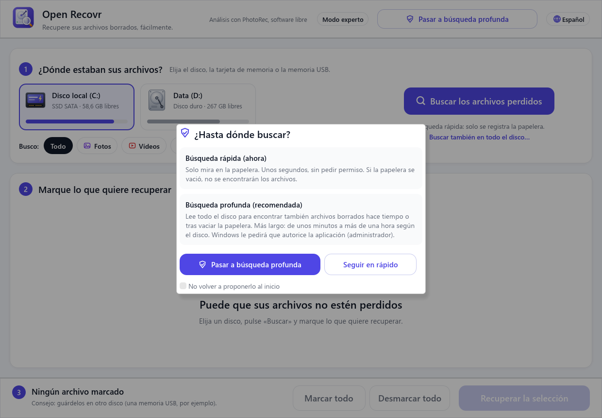
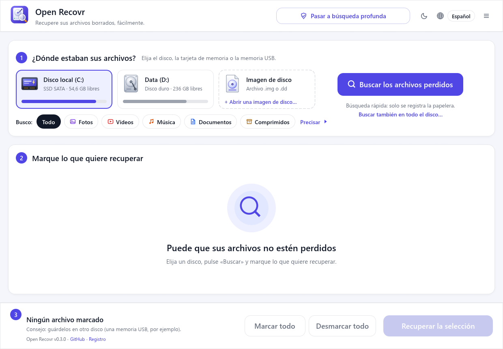
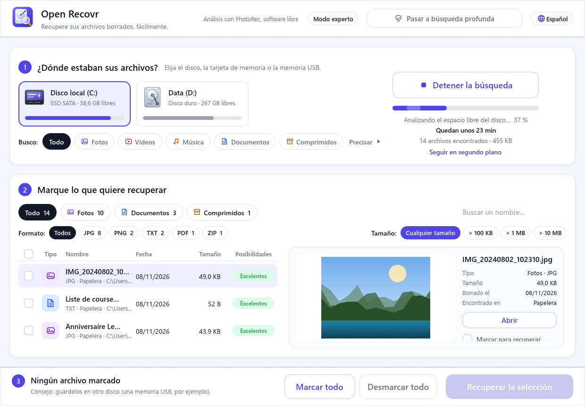
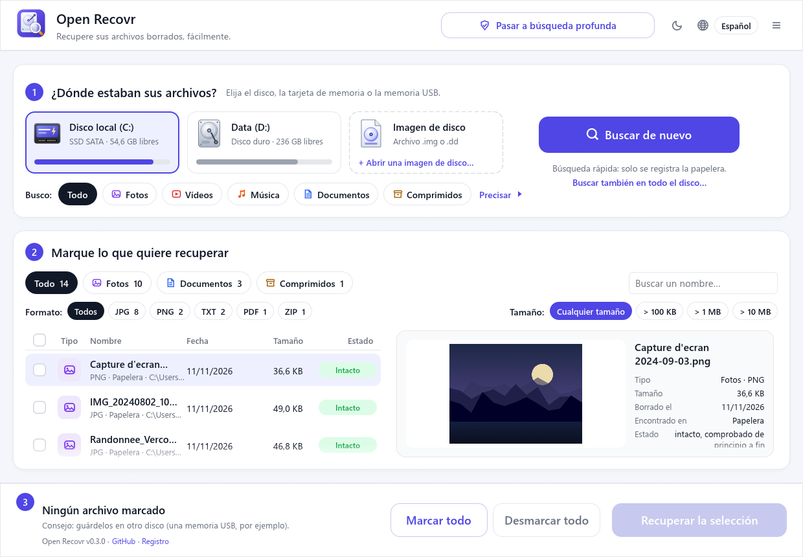
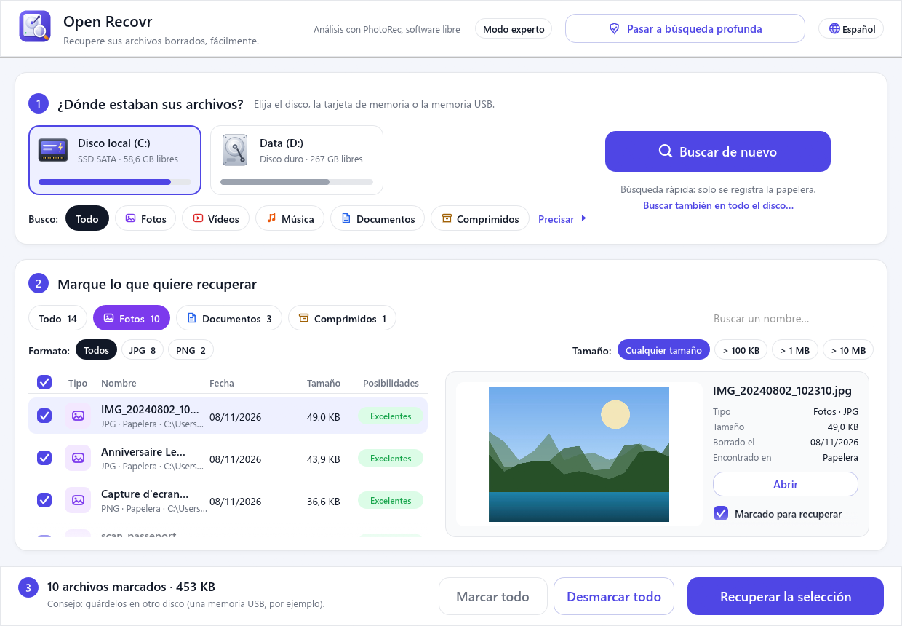
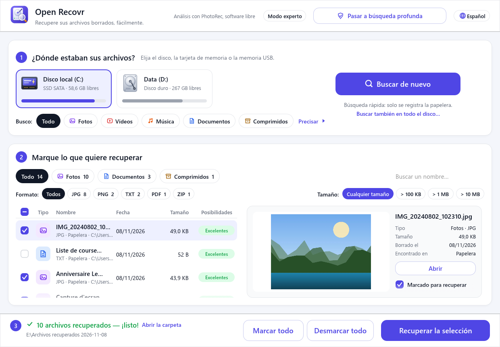
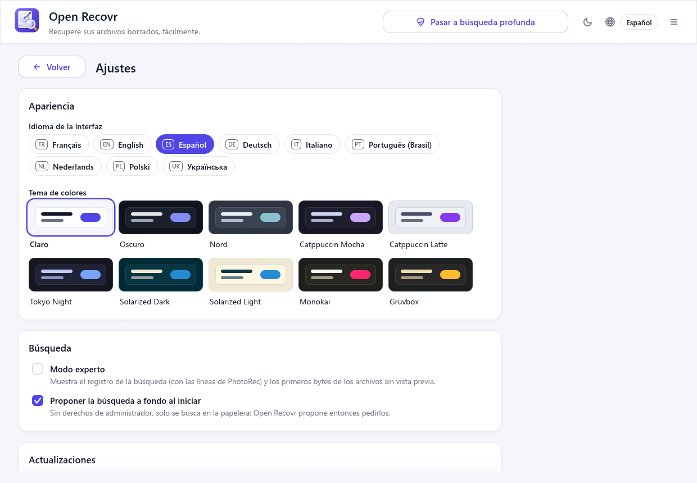
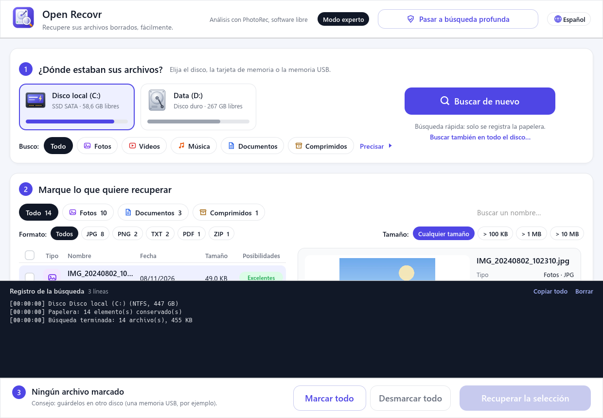

# Guía de uso

[English](user-guide.md) · [Français](user-guide.fr.md) · **Español** · [Deutsch](user-guide.de.md) · [Italiano](user-guide.it.md) · [Português (Brasil)](user-guide.pt.md) · [Nederlands](user-guide.nl.md) · [Polski](user-guide.pl.md) · [Українська](user-guide.uk.md)

Esta guía recorre una recuperación de principio a fin. La aplicación está en español, inglés, francés, alemán, italiano, portugués de Brasil, neerlandés, polaco y ucraniano: el botón de idioma está arriba a la derecha.

- [Antes de empezar](#antes-de-empezar)
- [1. Búsqueda rápida o profunda](#1-búsqueda-rápida-o-profunda)
- [2. Elegir la unidad y lo que buscas](#2-elegir-la-unidad-y-lo-que-buscas)
- [3. La búsqueda](#3-la-búsqueda)
- [4. Explorar los resultados](#4-explorar-los-resultados)
- [5. Marcar lo que quieres recuperar](#5-marcar-lo-que-quieres-recuperar)
- [6. Recuperar](#6-recuperar)
- [Imágenes de disco](#imágenes-de-disco)
- [Ajustes, temas y actualizaciones](#ajustes-temas-y-actualizaciones)
- [Modo experto](#modo-experto)
- [Pedir ayuda a alguien](#pedir-ayuda-a-alguien)
- [Preguntas frecuentes](#preguntas-frecuentes)

## Antes de empezar

**Usa la unidad lo menos posible.** Un archivo borrado sigue en la unidad hasta que algo nuevo se escribe encima. Cada descarga, instalación o guardado en esa unidad reduce tus posibilidades.

- Si los archivos estaban en la unidad del sistema (normalmente `C:`), no instales nada en ella. Ejecuta Open Recovr desde una memoria USB si puedes.
- Si estaban en una tarjeta de memoria o una memoria USB, sácala y no hagas más fotos con ella.
- **Ten preparada otra unidad** para recibir los archivos recuperados: una memoria USB, un disco externo o un segundo disco interno.

## 1. Búsqueda rápida o profunda

Al iniciarse, Open Recovr pregunta hasta dónde buscar:

- La **búsqueda rápida** solo mira en la papelera. Tarda unos segundos y no necesita permisos especiales. Si vaciaste la papelera, no encontrará nada.
- La **búsqueda profunda** lee la propia unidad. Necesita permisos de administrador: Windows te pide que autorices la aplicación (en Linux y macOS se te pide la contraseña).

Puedes cambiar más tarde con el botón **Pasar a búsqueda profunda** de arriba. Marca *No volver a proponerlo al inicio* si siempre eliges lo mismo.

## 2. Elegir la unidad y lo que buscas

**¿Dónde estaban sus archivos?** Haz clic en la unidad, tarjeta o memoria donde estaban los archivos. Cada una muestra su tipo (disco duro, SSD SATA o NVMe, tarjeta SD, memoria USB, CD…), su espacio libre y su nombre.

**Busco:** limita la búsqueda a *Fotos*, *Vídeos*, *Música*, *Documentos* o *Comprimidos*. Menos tipos hacen la búsqueda más rápida y la lista más corta. **Precisar** va más allá: formatos concretos (solo JPG, solo DOCX…) y un tamaño mínimo.

En búsqueda profunda, las unidades NTFS (la mayoría de los discos de Windows) ofrecen dos análisis:

| Análisis | Qué lee | Duración | ¿Conserva los nombres? |
|---|---|---|---|
| **Rápido** | La tabla de archivos de la unidad (MFT) | Unos minutos | ✅ nombre y carpeta |
| **Completo** | La tabla de archivos y luego toda la unidad con PhotoRec | De minutos a más de una hora | En parte (ver más abajo) |

Empieza por **Rápido**. Si tu archivo no aparece, haz clic en **¿No lo encuentra? Iniciar el análisis completo**.

En otros sistemas de archivos (tarjetas de memoria FAT32 y exFAT, ext4, APFS…), la búsqueda profunda pasa directamente al análisis completo.

## 3. La búsqueda

Haz clic en **Buscar los archivos perdidos**. Los archivos aparecen en la lista **en cuanto se encuentran**: no hace falta esperar al final para empezar a mirar.

El panel de la derecha muestra la fase actual, el avance, una estimación del tiempo restante y cuántos archivos se han encontrado hasta ahora.

- **Detener la búsqueda** conserva lo que ya se ha encontrado.
- **Seguir en segundo plano** oculta la ventana junto al reloj (Windows). Haz clic en el icono para recuperarla. Una notificación te avisa cuando termina la búsqueda.

Las zonas ilegibles, como un CD rayado o una tarjeta gastada, se saltan. La búsqueda continúa en lugar de quedarse bloqueada.

## 4. Explorar los resultados

- Las **pestañas** de arriba (*Todo*, *Fotos*, *Documentos*…) indican cuántos archivos de cada clase se han encontrado.
- **Formato** y **Tamaño** filtran más. El cuadro de búsqueda filtra por nombre.
- Haz clic en el título de una columna para **ordenar** por tipo, nombre, fecha o tamaño.
- Haz clic en un archivo para ver su **vista previa** a la derecha, con sus detalles. Se pueden previsualizar fotos, vídeos, sonidos, PDF, textos y documentos Word. **Abrir** lo abre en su programa habitual, a partir de una copia temporal.

Cada archivo encontrado se lee de principio a fin, y la columna **Estado** da el resultado:

| Estado | Significado |
|---|---|
| **Intacto** | El archivo se ha comprobado de principio a fin y está completo. Volverá tal cual. |
| **Dañado** | Falta una parte o es incorrecta. El detalle dice por qué: cortado, mezclado con otro archivo, índice ausente… Puede que aún se abra en parte. |
| **Vacío** | El espacio que ocupaba solo contiene ceros. Ya no queda nada que recuperar. |

Un mismo archivo se encuentra a menudo varias veces (en la papelera y en la unidad, por ejemplo). Las copias quedan ocultas tras un enlace *duplicados ocultos · Mostrar*.

Los archivos encontrados por PhotoRec no tienen nombre propio. Open Recovr les da uno a partir de su contenido cuando puede: `photo_2024-07-14_18-22-05.jpg` a partir de la fecha en que se tomó la foto, el título de un documento Word o PDF, el artista y la canción de un MP3.

## 5. Marcar lo que quieres recuperar

Marca los archivos uno a uno, o usa la casilla del encabezado de columna para marcar todo lo de la vista actual. **Marcar todo** y **Desmarcar todo**, abajo, actúan sobre toda la lista. La barra inferior indica cuántos archivos están marcados y su tamaño total.

## 6. Recuperar

Haz clic en **Recuperar la selección** y elige una carpeta **en otra unidad**. Si eliges la unidad analizada, Open Recovr te avisa de que podrías sobrescribir otros archivos recuperables.

Los archivos se copian en una carpeta nueva llamada *Archivos recuperados* seguida de la fecha, con una subcarpeta por clase (Fotos, Documentos…). Una carpeta enviada a la papelera vuelve entera. Al terminar, **Abrir la carpeta** te los muestra.

Nunca se escribe nada en la unidad analizada. Los archivos solo se leen de ella.

## Imágenes de disco

Una unidad que está fallando (hace ruidos, va muy lenta, da muchos errores de lectura) puede dejar de funcionar del todo durante la búsqueda. Es más seguro copiarla una vez, sector por sector, con una herramienta como [ddrescue](https://www.gnu.org/software/ddrescue/), y luego analizar la copia.

La tarjeta **Imagen de disco**, junto a las unidades, abre una copia así (`.img`, `.dd`, `.raw`…). La búsqueda funciona entonces como en una unidad, sin permisos de administrador, y el original no se toca.

## Ajustes, temas y actualizaciones

El menú de arriba a la derecha (☰) reúne todo lo que no sirve directamente para recuperar archivos:

- **Ajustes**: el idioma, el tema de colores, el modo experto, si se propone la búsqueda profunda al inicio, las actualizaciones e información sobre la aplicación.
- **Tema de colores**: claro, oscuro, Nord, Catppuccin, Tokyo Night, Solarized, Monokai o Gruvbox. El botón sol/luna, junto al idioma, cambia entre claro y oscuro con un clic.
- **Buscar actualizaciones**, **Preparar un informe…** y la página del proyecto en GitHub.

Cuando sale una versión nueva, la barra inferior muestra **→ v…: actualizar**. Un clic la descarga, comprueba que está firmada con la clave del proyecto, la instala y reinicia Open Recovr. Si hay una búsqueda o una recuperación en curso, la actualización espera a que termine.

## Modo experto

El **Modo experto**, en el menú de arriba a la derecha, muestra el registro de la búsqueda bajo la lista: la unidad y su sistema de archivos, cada fase y las líneas de PhotoRec. **Copiar todo** copia el registro, útil para informar de un problema. Arrastra el borde superior del registro para agrandarlo.

Cada búsqueda también se escribe en `journal.txt`, junto a los ajustes (`%APPDATA%\Open Recovr` en Windows). El enlace **Registro**, abajo, lo abre.

## Pedir ayuda a alguien

En el menú de arriba a la derecha (☰), **Preparar un informe…** guarda un zip que puedes enviar a quien te ayuda, por correo o de otra forma. Open Recovr solo escribe el archivo: nunca lo envía. Dentro hay archivos de texto: qué es el informe, el sistema y las unidades (modelo, tamaño, sistema de archivos), los ajustes y el registro de la última búsqueda. Antes de escribir nada se ocultan tu nombre de usuario, el nombre del equipo, tu carpeta personal y las direcciones de correo, igual que los títulos de documentos que PhotoRec pone en el nombre de los archivos que encuentra. Abre el zip y revísalo antes de pasarlo.

## Preguntas frecuentes

**Mi archivo no está en la lista. ¿Qué hago?**
Comprueba que está elegida la unidad correcta y que el filtro de tipo no lo oculta (*Todo*). Luego prueba la búsqueda profunda y, en NTFS, el análisis completo. Si la unidad se ha usado mucho desde el borrado, el archivo puede haberse sobrescrito. Entonces ningún programa puede recuperarlo.

**Los archivos recuperados se llaman `f1234567.jpg`.**
Esos archivos los encontró PhotoRec, que reconoce un archivo por su contenido y no por la tabla de archivos: su nombre original es desconocido. Cuando el propio archivo no dice nada de su fecha o su título, el número se queda. Ordena por fecha o tamaño y usa la vista previa para encontrar el tuyo.

**Un archivo aparece como Dañado. ¿Merece la pena recuperarlo?**
A menudo, sí. Una foto dañada puede mostrar solo su mitad superior, un vídeo dañado puede reproducirse hasta la parte estropeada. Recupéralo y pruébalo: no cuesta nada, y la unidad nunca se modifica.

**¿Puede recuperar archivos de mi teléfono?**
Por USB, no. Un teléfono solo comparte los archivos que aún tiene, y su memoria está cifrada. Mira en la papelera de la app Galería o Fotos (las fotos borradas suelen guardarse 30 días), en Google Fotos o iCloud, o pon la tarjeta microSD del teléfono en un lector de tarjetas y analízala.

**¿Funciona en un SSD?**
En parte. La mayoría de los SSD borran en segundo plano los bloques eliminados (TRIM): los archivos borrados hace tiempo suelen haberse perdido para siempre. La papelera y la tabla de archivos todavía ayudan con los borrados recientes. Actúa rápido.

**¿Se pueden recuperar archivos de una unidad formateada?**
A menudo, sí, con el análisis completo. Un formateo rápido deja el contenido en su sitio. Un formateo completo (o «borrado seguro») lo sobrescribe.

**¿Por qué la búsqueda profunda necesita permisos de administrador?**
Lee la unidad sector por sector, por debajo del sistema de archivos, y el sistema operativo reserva eso a los administradores. Open Recovr solo lee: nunca escribe en esa unidad.

**¿Es seguro? ¿Envía mis datos a algún sitio?**
Open Recovr funciona sin conexión. Sin cuenta y sin telemetría. Su única conexión es la búsqueda de actualizaciones: al iniciarse pide a GitHub el número de la última versión, y no envía nada más. Desmarca «Buscar actualizaciones al iniciar» en Ajustes para desactivarla; el menú puede seguir comprobándolo cuando lo pidas. Una actualización solo se instala si está firmada con la clave del proyecto, que nunca va a GitHub: una versión falsa subida por otra persona se rechaza. El código es abierto: compruébalo tú mismo.

**Linux / macOS: la búsqueda profunda dice que PhotoRec no está disponible.**
Instálalo: `sudo apt install testdisk` (Debian, Ubuntu), `sudo dnf install testdisk` (Fedora) o `brew install testdisk` (macOS). Open Recovr encuentra entonces `photorec` por sí solo. Sin él, un motor integrado más sencillo busca los formatos más comunes.
