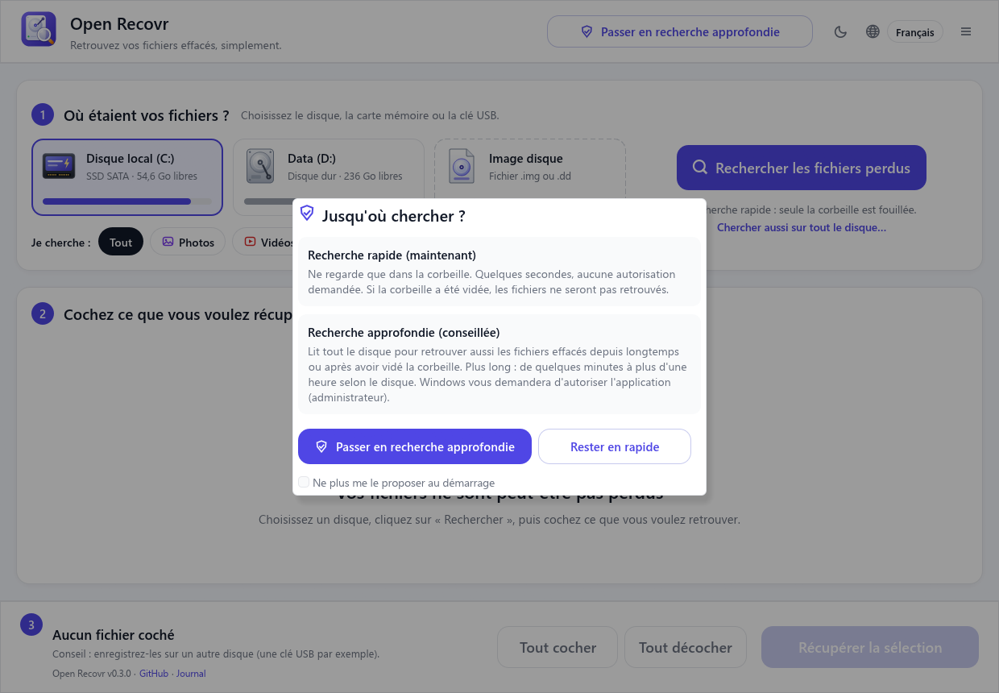
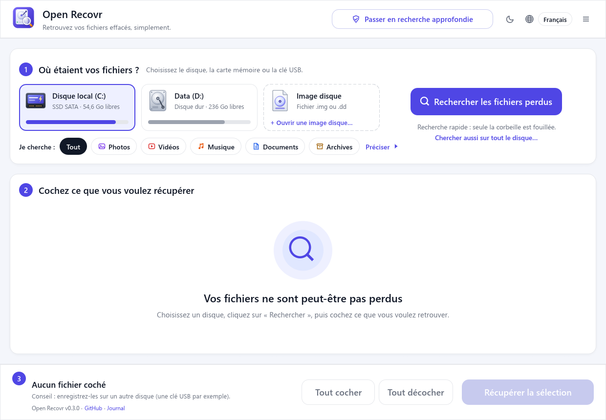
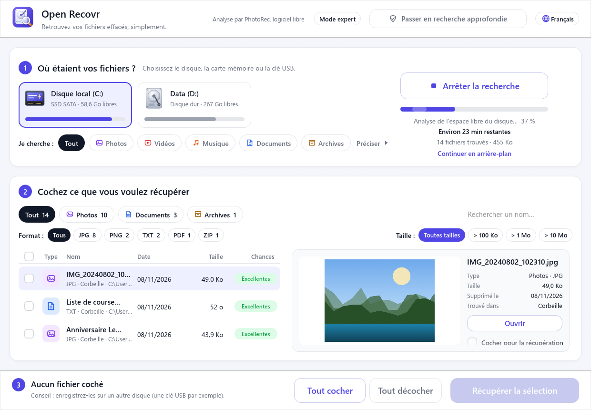
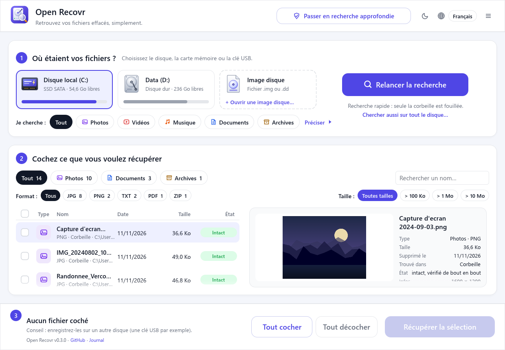
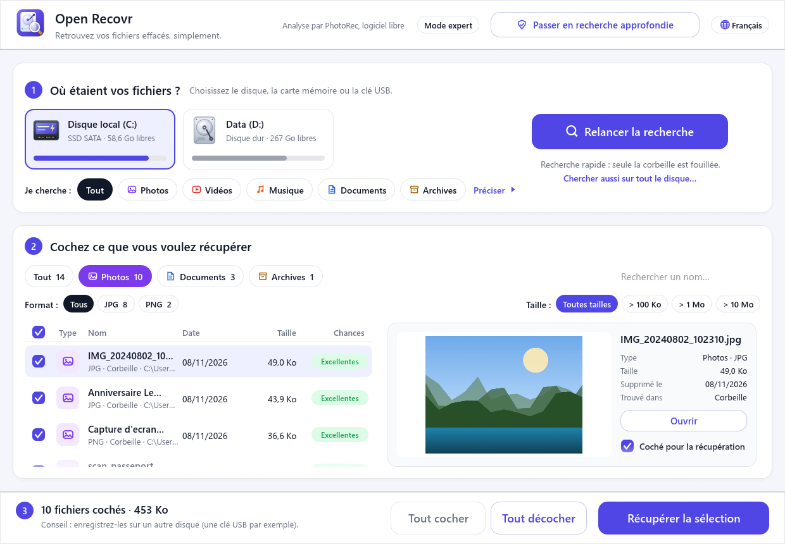
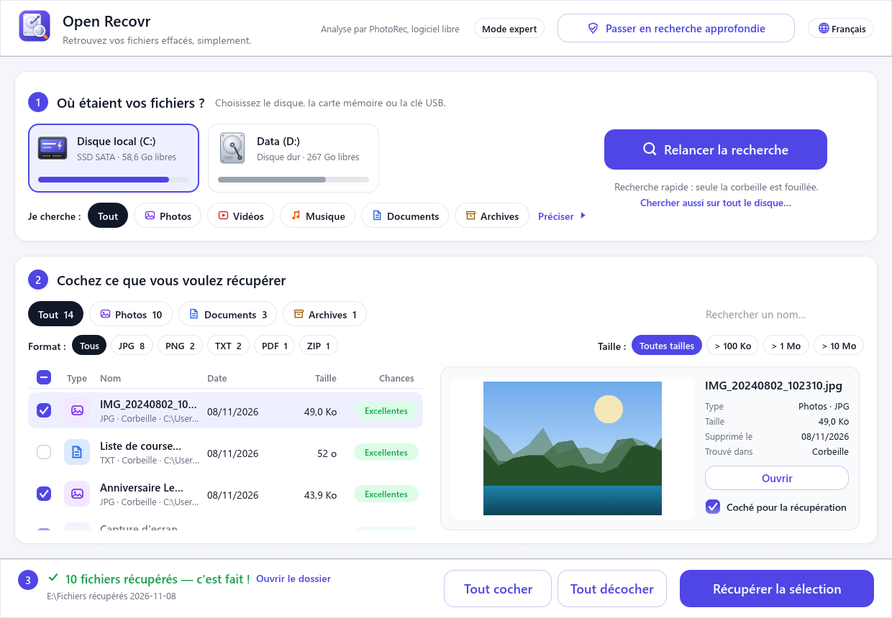
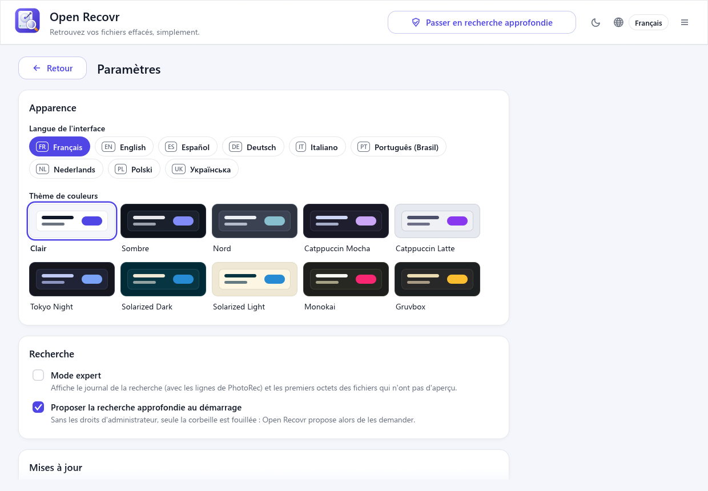
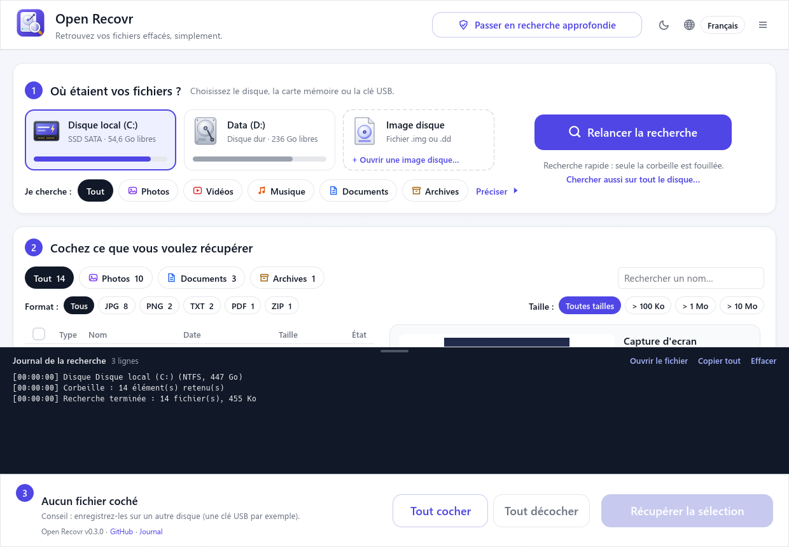

# Guide d'utilisation

[English](user-guide.md) · **Français** · [Español](user-guide.es.md) · [Deutsch](user-guide.de.md) · [Italiano](user-guide.it.md) · [Português (Brasil)](user-guide.pt.md) · [Nederlands](user-guide.nl.md) · [Polski](user-guide.pl.md) · [Українська](user-guide.uk.md)

Ce guide déroule une récupération du début à la fin. L'application parle français, anglais, espagnol, allemand, italien, portugais du Brésil, néerlandais, polonais et ukrainien : le bouton de langue est en haut à droite.

- [Avant de commencer](#avant-de-commencer)
- [1. Recherche rapide ou approfondie](#1-recherche-rapide-ou-approfondie)
- [2. Choisir le disque et ce que vous cherchez](#2-choisir-le-disque-et-ce-que-vous-cherchez)
- [3. La recherche](#3-la-recherche)
- [4. Parcourir les résultats](#4-parcourir-les-résultats)
- [5. Cocher ce que vous voulez récupérer](#5-cocher-ce-que-vous-voulez-récupérer)
- [6. Récupérer](#6-récupérer)
- [Images disque](#images-disque)
- [Paramètres, thèmes et mises à jour](#paramètres-thèmes-et-mises-à-jour)
- [Mode expert](#mode-expert)
- [Demander de l'aide à quelqu'un](#demander-de-laide-à-quelquun)
- [Questions fréquentes](#questions-fréquentes)

## Avant de commencer

**Utilisez le disque le moins possible.** Un fichier effacé reste sur le disque tant que rien de nouveau n'est écrit par-dessus. Chaque téléchargement, installation ou enregistrement sur ce disque réduit vos chances.

- Si les fichiers étaient sur le disque système (en général `C:`), n'y installez rien. Lancez Open Recovr depuis une clé USB si vous le pouvez.
- S'ils étaient sur une carte mémoire ou une clé USB, retirez-la et ne prenez plus de photos avec.
- **Préparez un autre disque** pour recevoir les fichiers récupérés : une clé USB, un disque externe ou un second disque interne.

## 1. Recherche rapide ou approfondie

Au démarrage, Open Recovr demande jusqu'où chercher :

- La **recherche rapide** ne regarde que dans la corbeille. Elle prend quelques secondes et ne demande aucun droit particulier. Si vous avez vidé la corbeille, elle ne trouvera rien.
- La **recherche approfondie** lit le disque lui-même. Elle demande les droits administrateur : Windows vous demande d'autoriser l'application (sous Linux et macOS, votre mot de passe vous est demandé).

Vous pouvez changer plus tard avec le bouton **Passer en recherche approfondie** en haut. Cochez *Ne plus me le proposer au démarrage* si vous faites toujours le même choix.

## 2. Choisir le disque et ce que vous cherchez

**Où étaient vos fichiers ?** Cliquez sur le disque, la carte ou la clé où se trouvaient les fichiers. Chacun affiche son type (disque dur, SSD SATA ou NVMe, carte SD, clé USB, CD…), son espace libre et son nom.

**Je cherche :** limite la recherche aux *Photos*, *Vidéos*, *Musique*, *Documents* ou *Archives*. Moins de types, c'est une recherche plus rapide et une liste plus courte. **Préciser** va plus loin : des formats précis (seulement JPG, seulement DOCX…) et une taille minimale.

En recherche approfondie, les disques NTFS (la plupart des disques Windows) proposent deux analyses :

| Analyse | Ce qu'elle lit | Durée | Noms conservés ? |
|---|---|---|---|
| **Rapide** | La table des fichiers du disque (MFT) | Quelques minutes | ✅ nom et dossier |
| **Complète** | La table des fichiers, puis tout le disque avec PhotoRec | De quelques minutes à plus d'une heure | En partie (voir plus bas) |

Commencez par **Rapide**. Si votre fichier n'y est pas, cliquez sur **Pas trouvé ? Lancer l'analyse complète**.

Sur les autres systèmes de fichiers (cartes mémoire FAT32 et exFAT, ext4, APFS…), la recherche approfondie passe directement à l'analyse complète.

## 3. La recherche

Cliquez sur **Rechercher les fichiers perdus**. Les fichiers apparaissent dans la liste **dès qu'ils sont trouvés** : inutile d'attendre la fin pour commencer à regarder.

Le panneau de droite affiche l'étape en cours, l'avancement, une estimation du temps restant et le nombre de fichiers trouvés jusque-là.

- **Arrêter la recherche** garde ce qui a déjà été trouvé.
- **Continuer en arrière-plan** range la fenêtre près de l'horloge (Windows). Cliquez sur l'icône pour la faire revenir. Une notification vous prévient quand la recherche est terminée.

Les zones illisibles, comme un CD rayé ou une carte usée, sont sautées. La recherche continue au lieu de rester bloquée.

## 4. Parcourir les résultats

- Les **onglets** en haut (*Tout*, *Photos*, *Documents*…) indiquent combien de fichiers de chaque sorte ont été trouvés.
- **Format** et **Taille** filtrent davantage. La zone de recherche filtre par nom.
- Cliquez sur un titre de colonne pour **trier** par type, nom, date ou taille.
- Cliquez sur un fichier pour l'**aperçu** à droite, avec ses détails. Photos, vidéos, sons, PDF, textes et documents Word peuvent être prévisualisés. **Ouvrir** l'ouvre dans son programme habituel, à partir d'une copie temporaire.

Chaque fichier trouvé est lu de bout en bout, et la colonne **État** donne le résultat :

| État | Signification |
|---|---|
| **Intact** | Le fichier a été vérifié du début à la fin et il est complet. Il reviendra tel quel. |
| **Endommagé** | Une partie manque ou est fausse. Le détail dit pourquoi : coupé, mélangé à un autre fichier, index manquant… Il peut encore s'ouvrir en partie. |
| **Vide** | La place qu'il occupait ne contient que des zéros. Il n'y a plus rien à récupérer. |

Un même fichier est souvent trouvé plusieurs fois (dans la corbeille et sur le disque, par exemple). Les copies sont masquées derrière un lien *doublons masqués · Afficher*.

Les fichiers trouvés par PhotoRec n'ont pas de nom à eux. Open Recovr leur en donne un d'après leur contenu quand il le peut : `photo_2024-07-14_18-22-05.jpg` d'après la date de prise de vue, le titre d'un document Word ou PDF, l'artiste et le titre d'un MP3.

## 5. Cocher ce que vous voulez récupérer

Cochez les fichiers un par un, ou utilisez la case dans l'en-tête de colonne pour tout cocher dans la vue en cours. **Tout cocher** et **Tout décocher**, en bas, agissent sur toute la liste. La barre du bas indique combien de fichiers sont cochés et leur taille totale.

## 6. Récupérer

Cliquez sur **Récupérer la sélection** et choisissez un dossier **sur un autre disque**. Si vous choisissez le disque fouillé, Open Recovr vous prévient que vous risquez d'écraser d'autres fichiers récupérables.

Les fichiers sont copiés dans un nouveau dossier nommé *Fichiers récupérés* suivi de la date, avec un sous-dossier par sorte (Photos, Documents…). Un dossier envoyé à la corbeille revient en entier. À la fin, **Ouvrir le dossier** vous les montre.

Rien n'est jamais écrit sur le disque fouillé. Les fichiers y sont seulement lus.

## Images disque

Un disque en train de lâcher (qui claque, très lent, plein d'erreurs de lecture) peut rendre l'âme pendant la recherche. Il est plus sûr de le copier une fois, secteur par secteur, avec un outil comme [ddrescue](https://www.gnu.org/software/ddrescue/), puis de fouiller la copie.

La carte **Image disque**, à côté des disques, ouvre une telle copie (`.img`, `.dd`, `.raw`…). La recherche fonctionne alors comme sur un disque, sans droits administrateur, et l'original n'est pas touché.

## Paramètres, thèmes et mises à jour

Le menu en haut à droite (☰) rassemble tout ce qui ne sert pas directement à récupérer des fichiers :

- **Paramètres** : la langue, le thème de couleurs, le mode expert, la proposition de recherche approfondie au démarrage, les mises à jour et des informations sur l'application.
- **Thème de couleurs** : clair, sombre, Nord, Catppuccin, Tokyo Night, Solarized, Monokai ou Gruvbox. Le bouton soleil/lune, à côté de la langue, passe du clair au sombre en un clic.
- **Rechercher les mises à jour**, **Préparer un rapport…** et la page du projet sur GitHub.

Quand une nouvelle version sort, la barre du bas affiche **→ v… : mettre à jour**. Un clic la télécharge, vérifie qu'elle est signée avec la clé du projet, l'installe et relance Open Recovr. Si une recherche ou une récupération est en cours, la mise à jour attend qu'elle soit finie.

## Mode expert

Le **Mode expert**, dans le menu en haut à droite, affiche le journal de la recherche sous la liste : le disque et son système de fichiers, chaque étape et les lignes de PhotoRec. **Copier tout** copie le journal, pratique pour signaler un problème. Tirez le bord supérieur du journal pour l'agrandir.

Chaque recherche est aussi écrite dans `journal.txt`, à côté des réglages (`%APPDATA%\Open Recovr` sous Windows). Le lien **Journal**, en bas, l'ouvre.

## Demander de l'aide à quelqu'un

Dans le menu en haut à droite (☰), **Préparer un rapport…** enregistre un zip à envoyer à la personne qui vous aide, par mail ou autrement. Open Recovr se contente d'écrire le fichier : il ne l'envoie jamais. Il contient des fichiers texte : ce qu'est ce rapport, le système et les disques (modèle, taille, système de fichiers), les réglages et le journal de la dernière recherche. Avant d'écrire quoi que ce soit, votre nom de compte, le nom de l'ordinateur, votre dossier personnel et les adresses mail sont masqués, tout comme les titres de documents que PhotoRec met dans le nom des fichiers qu'il trouve. Ouvrez le zip et relisez-le avant de le transmettre.

## Questions fréquentes

**Mon fichier n'est pas dans la liste. Que faire ?**
Vérifiez que le bon disque est choisi et que le filtre de type ne le cache pas (*Tout*). Essayez ensuite la recherche approfondie, et sur NTFS l'analyse complète. Si le disque a beaucoup servi depuis l'effacement, le fichier a pu être écrasé. Aucun logiciel ne peut plus le ramener.

**Les fichiers récupérés s'appellent `f1234567.jpg`.**
Ces fichiers ont été trouvés par PhotoRec, qui reconnaît un fichier à son contenu et non grâce à la table des fichiers : leur nom d'origine est inconnu. Quand le fichier lui-même ne dit rien de sa date ou de son titre, le numéro reste. Triez par date ou par taille, et servez-vous de l'aperçu pour retrouver le vôtre.

**Un fichier est marqué Endommagé. Vaut-il la peine de le récupérer ?**
Souvent, oui. Une photo endommagée peut n'afficher que sa moitié haute, une vidéo endommagée peut se lire jusqu'au passage abîmé. Récupérez-le et essayez : ça ne coûte rien, et le disque n'est jamais modifié.

**Peut-il récupérer les fichiers de mon téléphone ?**
Pas en USB. Un téléphone ne partage que les fichiers qu'il a encore, et sa mémoire est chiffrée. Regardez dans la corbeille de l'appli Galerie ou Photos (les photos effacées y restent en général 30 jours), dans Google Photos ou iCloud, ou mettez la carte microSD du téléphone dans un lecteur de cartes et fouillez-la.

**Est-ce que ça marche sur un SSD ?**
En partie. La plupart des SSD effacent les blocs supprimés en arrière-plan (TRIM) : les fichiers effacés depuis un moment sont souvent perdus pour de bon. La corbeille et la table des fichiers aident encore pour les effacements récents. Agissez vite.

**Peut-on récupérer les fichiers d'un disque formaté ?**
Souvent, oui, avec l'analyse complète. Un formatage rapide laisse le contenu en place. Un formatage complet (ou « effacement sécurisé ») l'écrase.

**Pourquoi la recherche approfondie demande-t-elle les droits administrateur ?**
Elle lit le disque secteur par secteur, sous le système de fichiers, et le système d'exploitation réserve cela aux administrateurs. Open Recovr ne fait que lire : il n'écrit jamais sur ce disque.

**Est-ce sûr ? Mes données partent-elles quelque part ?**
Open Recovr fonctionne hors ligne. Pas de compte, pas de télémétrie. Sa seule connexion est la recherche de mises à jour : au démarrage, il demande à GitHub le numéro de la dernière version, et n'envoie rien d'autre. Décochez « Rechercher les mises à jour au démarrage » dans les Paramètres pour la couper ; le menu peut toujours vérifier à la demande. Une mise à jour n'est installée que si elle est signée avec la clé du projet, qui ne va jamais sur GitHub : une fausse version déposée par quelqu'un d'autre est refusée. Le code est ouvert : vous pouvez vérifier.

**Linux / macOS : la recherche approfondie dit que PhotoRec n'est pas disponible.**
Installez-le : `sudo apt install testdisk` (Debian, Ubuntu), `sudo dnf install testdisk` (Fedora) ou `brew install testdisk` (macOS). Open Recovr trouve alors `photorec` tout seul. Sans lui, un moteur intégré plus simple cherche les formats les plus courants.
